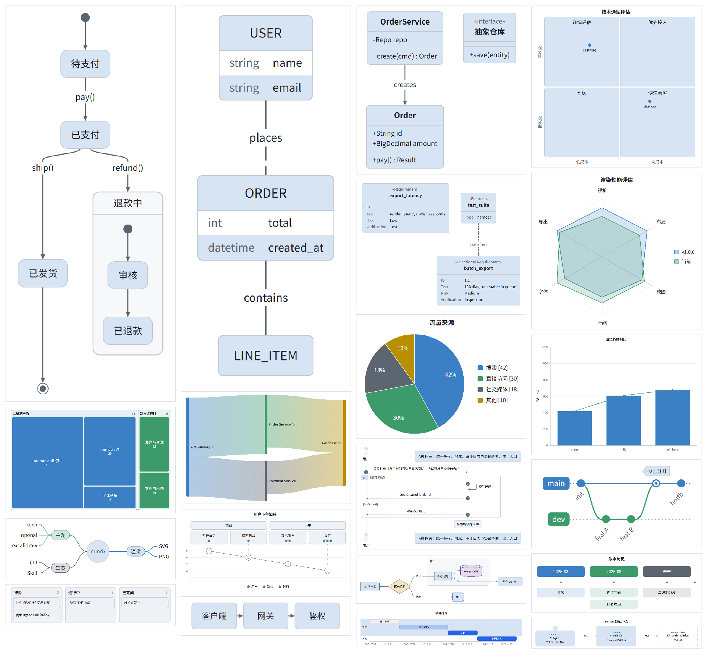
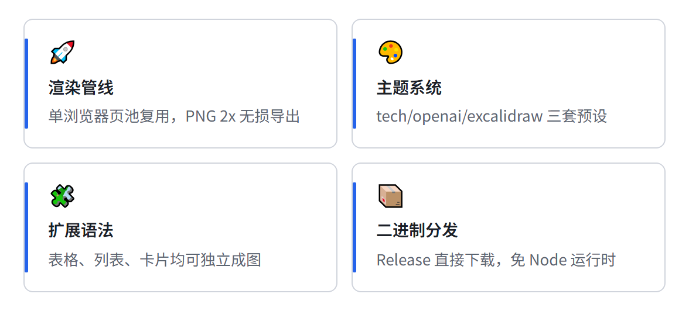
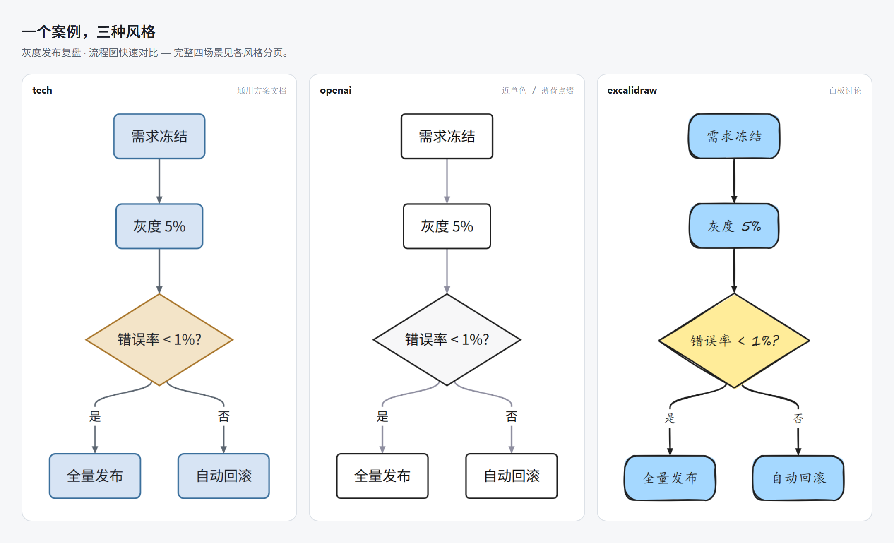

> [中文](README.md) · English

# mmdx

[](https://github.com/daidaiJ/mmdx/releases/latest)
[](LICENSE)

**A diagram export CLI built for office agents**: batch-render mermaid and office fences (table / chart / kpi / compare / vs / funnel / task / progress / gauge / heatmap / swimlane …) in Markdown into PNG — themes, CJK fonts, layout engine, and padding are all built in. No MCP server, no browser extension, and the machine producing the output doesn't need Node.



## 📖 Documentation

| Reader | Doc | What's inside |
|---|---|---|
| 🤖 AI Agent | [docs/AGENT_GUIDE.en.md](docs/AGENT_GUIDE.en.md) | Token-lean: env self-check, diagram picking, flag cheatsheet, JSON contract, error triage |
| 👤 Human user | [docs/HUMAN_GUIDE.en.md](docs/HUMAN_GUIDE.en.md) | Readable: install & deploy, full CLI reference, theming, performance tuning, troubleshooting |
| 🖼 Extension blocks | [docs/EXTENSIONS.en.md](docs/EXTENSIONS.en.md) | One tool-rendered PNG + syntax per fence |
| 🎭 Style gallery | [docs/GALLERY.en.md](docs/GALLERY.en.md) | One case across three styles: flowchart / KPI / cards / table |
| 🧪 Quality gates | [docs/QUALITY.en.md](docs/QUALITY.en.md) | Pixel-lint coverage, known blind spots, pre-release license checklist |
| 🖋 Hand-drawn editorial specs | [skill/editorial/](skill/editorial/README.md) | Vendored diagram-design specs (MIT): hand-draw covers / proposal art per its specs and export with `mmdx file.html --scale 3` |
| 📃 Narrative explainer specs | [skill/explain/](skill/explain/README.md) | Vendored spec-only adaptation of visual-explainer (MIT): explainers / review pages / recaps / slide decks assembled from a starter, exported with the same command |
| 📚 Skill reference cards | [skill/references/](skill/references/) | Fence syntax, diagram examples, themes & engines, troubleshooting — read on demand |
| 📜 Changelog | [CHANGELOG.md](CHANGELOG.md) | Release history |

Every doc is Chinese-first with an English `.en.md` sibling of the same name.

## ✨ Highlights

- **Pele default engine**: Obsidian's Mermaid→SVG renderer, 1–50 ms per diagram; Mermaid 11 + ELK retained as `--engine mermaid` fallback
- **CSS-variable themes**: Pele exposes every color/font/radius as `--pele-*`; `-f svg` bakes hex by default, `--svg-themeable` keeps a re-themeable SVG; three presets share shape coding (blue = process, amber = decision, green = state, purple = storage)
- **Bundled CJK fonts (three families)**: GB2312 subsets of Noto Sans SC (universal), Noto Serif SC (serif stacks), and LXGW WenKai (kai labels) — ~6.2 MB total, identical rendering on any machine, correct wrapping for Chinese labels; the serif/kai faces and the `sans-serif` / `serif` CJK fallback aliases are injected for authored HTML documents only — fences and mermaid keep the sans face alone
- **Pixel-level even padding**: every image is re-cropped to its ink bounding box; symmetric margins are a construction guarantee, not the engine's unreliable viewBox
- **Extension blocks**: ```table / ```list / ```card / ```chart / ```kpi / ```compare / ```vs / ```funnel / ```task / ```progress / ```gauge / ```heatmap / ```swimlane straight to PNG
- **Office delivery**: `--preset slide|a4|square|column`, title/source/unit chrome, `--brand` accent; agent-friendly `--json` (including `warnings`)
- **Whole-page HTML shots**: `mmdx page.html` screenshots the page as-is to PNG (fullPage, PNG only) — system Edge, no Playwright, the page keeps its own styles/scripts/background; pairs with the vendored [diagram-design](skill/editorial/README.md) specs for hand-drawn editorial images
- **Figure lint**: exporting a `.html` input inspects every figure — overflow (`figure-overflow`), text on shape/text (`figure-text-overlap`), adhesion (`figure-text-adhesion`), effective font size <11px (`figure-small-text`), missing caption (`figure-uncaptioned`), missing `aria-label` (`svg-aria-label`); messages carry coordinates and land in `--json.warnings`
- **explain narrative tier**: `skill/explain/` ships four register starters (instrument / blueprint / paper / editorial) with the kit design system and Latin fonts already inlined — copy one, edit the body, `mmdx name.html --scale 3`

## 🚀 Quick start

```bash
# Option A: Release binary (windows x64, no Node; rendering uses system Edge/Chrome)
#   Latest: https://github.com/daidaiJ/mmdx/releases/latest
#   Direct: https://github.com/daidaiJ/mmdx/releases/latest/download/mmdx-windows-x64.exe

# Option B: dynamic runtime (needs bun)
#   Download mmdx-dynamic-<tag>.zip, then:
unzip mmdx-dynamic-v*.zip && cd mmdx-dynamic && bun install && bun run src/cli.ts --help

# Option C: clone & build
bun run build && ./dist/mmdx-windows-x64.exe --help
```

### Browser dependency

The render kernel is a real Chromium. Windows 10/11 **ships with Microsoft Edge**, so the binary works out of the box; Chrome works too. Detection order is Edge → Chrome at their common install paths; pass `--browser <path>` for any other Chromium. If none is found it fails fast and lists the searched paths — **Chromium is never downloaded**.

### First image in 30 seconds

```bash
mmdx README.md                              # README-m1.(svg|png), README-m2.(png|svg) …
echo "graph LR; A-->B" | mmdx - -f svg      # single diagram from stdin
```

More (multi-file batches, exact naming, title injection) in the [HUMAN_GUIDE quick start](docs/HUMAN_GUIDE.en.md#quick-start).

The default engine is Pele. Use `--engine mermaid` for ELK or Mermaid-only syntax (`--layout elk` selects Mermaid automatically); `--engine auto` tries Pele first and falls back. `-f svg` bakes theme colors to hex; `--svg-themeable` keeps `--pele-*` CSS variables.

## 🖼 Usage

```bash
mmdx a.md b.md other/*.md -o dist/          # multi-file batch, parallel
mmdx diagram.mmd -o out/arch.svg            # exact name; sibling .png written alongside
mmdx page.html -o out/page.png --scale 2    # whole-page HTML screenshot (Playwright-free)
mmdx report.md --index 2 --title "Architecture" --title-pos bottom
mmdx doc.md -t tech --background transparent -f png --json
```

Fence languages: `mermaid` (diagrams) plus `table` / `list` / `card` / `chart` / `kpi` / `compare` / `vs` / `funnel` / `task` / `progress` / `gauge` / `heatmap` / `swimlane` (extension blocks, PNG only). For slides: `mmdx doc.md --preset slide --title "…" --source "…"`. For chat / a narrow column: `--preset column`. Standalone `.html` files are screenshotted whole (own styles and background kept, bundled CJK font fills the fallback chain) — see [HUMAN_GUIDE](docs/HUMAN_GUIDE.en.md#whole-page-html-screenshots).

**Card wall** — a ```card fence, one card per line: `emoji | title | description` (emoji and description optional):

```card
🚀 | Render pipeline | single-browser page pool, lossless 2x PNG export
🎨 | Theme system | three presets, customizable via theme-js, tone and css
```



## 🎨 Themes

| | |
| --- | --- |
| `tech` (default) | Design-doc style: white background, shape coding, thin borders, orthogonal edges |
| `openai` | Near-monochrome engineering look: white ground, ink text, mint (teal) accent, hairline borders; pair with `--tone paper` for serif captions and 16px block cards |
| `excalidraw` | Hand-drawn: pastel fills + rough ink strokes, Excalifont/LXGW; whiteboard-style blocks |

`excalidraw` uses solid fills by default; add `--style-fill hachure` for hatched fills (about 1.5–2× larger SVG; keep solid for projectors).

`--tone paper|neutral|product` changes block structure only (radius, shadow, display type, table headers); the palette still comes from the theme. Info cards are a standalone skill, [`info-card-designer`](skill/info-card-designer/SKILL.md), applying the same theme and tone to Markdown or a web article:

```bash
mmdx card --in note.md -t openai --tone neutral --width 600 -o note-card.png
mmdx card --url https://example.com/post -t openai --tone paper
```

Layering order: preset → `--brand` → `--theme-js` → `--config` → `--css`. v2 `--theme-js` receives a `ThemeSpec` (`theme.vars` / `theme.shapes` / `theme.css`); examples in the [HUMAN_GUIDE theming section](docs/HUMAN_GUIDE.en.md#theming).

## 🖋 Hand-drawn HTML & explain

`mmdx page.html --scale 3` is the single export path for hand-authored HTML: the page is screenshotted as-is, keeping its own styles/scripts/background, with the three bundled CJK families filling the fallback. Two vendored specs (MIT) sit at different tiers:

| Tier | Spec | How to use |
| --- | --- | --- |
| Editorial cover / proposal art | [skill/editorial/](skill/editorial/README.md) (diagram-design) | Hand-draw a self-contained HTML per its general rules + `references/type-*.md`, then `mmdx name.html --scale 3` |
| Narrative explainer / review page / recap / slide deck | [skill/explain/](skill/explain/README.md) (spec-only adaptation of visual-explainer) | Copy `skill/explain/kit/starter-<register>.html` (instrument / blueprint / paper / editorial) → edit the body → `mmdx name.html --scale 3` |

Starters already inline the kit design system and that register's Latin fonts, so the head needs no edits; in-page mermaid is pre-rendered with `mmdx - -f svg` and inlined. Export runs figure lint automatically — fix `--json.warnings` to zero before shipping. The starter generator `scripts/explain-starter.ts` relies on bun's `import.meta.dir` and is only needed to regenerate starters.

## 🎭 Style gallery

The same “gray release retrospective” case in `tech`, `openai`, and `excalidraw`; the Markdown stays identical and only `-t` changes. The overview keeps one flowchart for a quick comparison:

[](docs/GALLERY.en.md)

Also see [two HTML scenario templates](docs/gallery/html-skills.en.md) (report cards and info cards across styles), [hand-drawn HTML templates](docs/gallery/vendored-html.en.md) (v1.4.2 editorial / visual-explainer), and the [info-card tone comparison](docs/gallery/card-tones.en.md) (paper / neutral / product).

The full four scenes (flowchart / KPI / cards / table) live on one page per style. Selection guide and reproduce command: [docs/GALLERY.en.md](docs/GALLERY.en.md).

## ⚡ Pipeline & performance

One Chromium + page pool + bounded workers; observable via `--profile`:

```
browser-launch  ~0.5s ×1      pele-render     ~26ms ×diagram
page-init       ~1.0s ×page   screenshot      ~90ms ×diagram (incl. pixel-level re-crop)
```

- Pele bundle (~700 KB) is injected on demand; Mermaid (3.5 MB) and ELK (7 MB bundle) are parsed only for `--engine mermaid` / `--engine auto` fallback
- Screenshots serialized across pages (headless Chrome serves one active tab) + viewport fitted to content; a 2x hi-res diagram still lands around ~100 ms
- A hung render always errors after 60s instead of stalling the batch; each diagram is retried once
- PNG is lossless 2x (typical architecture diagram 20–80 KB); SVG is minified by svgo — the official browser build is embedded in the binary (self-contained ESM), so minified SVG is as turnkey as PNG

Tuning knobs (concurrency, viewport, scale) in the [HUMAN_GUIDE performance section](docs/HUMAN_GUIDE.en.md#performance-tuning).

## 🧪 Testing

`bun run tests/run.ts`, four layers — visual review only looks at items the script flags as suspicious:

1. **Library sweep**: 20 mermaid diagram types + table/list/card, rendered in one browser session, then pixel-analyzed (margin symmetry ±8px, content ratio, bottom blank band, blank-image detection)
2. **CLI behavior**: exit codes, `--index` naming, bad-block isolation, stdin, JSON contract, figure-lint warnings for `.html` input, multi-file 4-concurrency batch
3. **Info cards**: Markdown/web extraction, width, pixel-height splitting, tone structure differences
4. **Visual lint**: DOM overflow/outside elements/caption overlap, SVG label overflow, rendered contrast, PNG edge clipping, two-run determinism; rules in [docs/QUALITY.en.md](docs/QUALITY.en.md)

## License

[MIT](LICENSE). Third-party components, fonts, and design references are attributed in [THIRD_PARTY_NOTICES.md](THIRD_PARTY_NOTICES.md).
