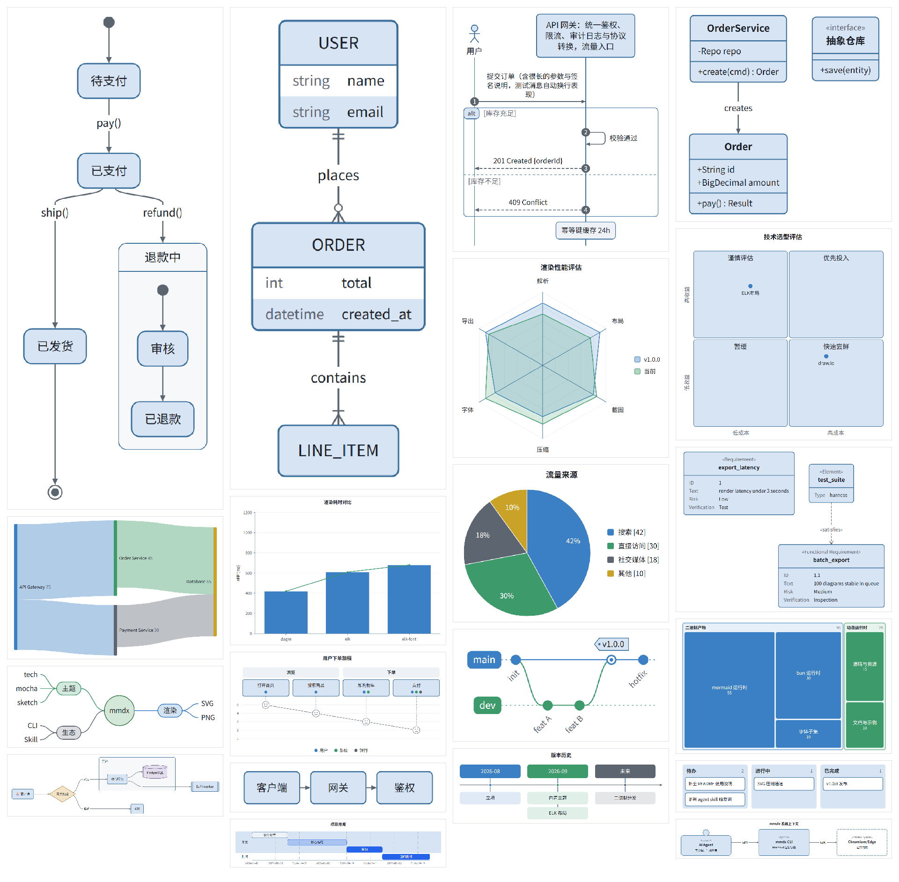
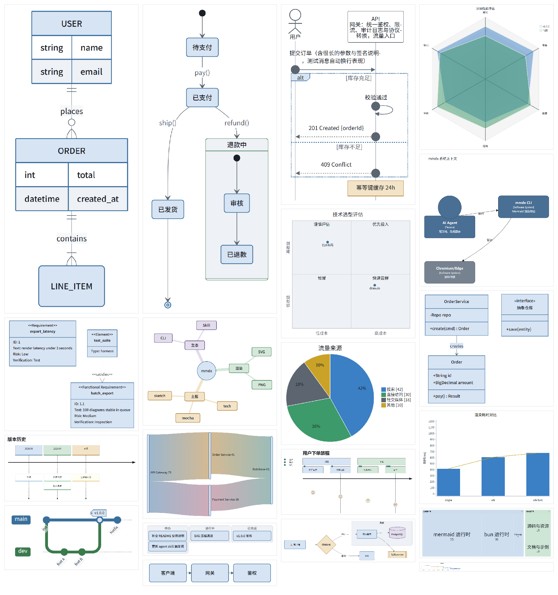

> [English](README.en.md) · 中文

# mmdx

[](https://github.com/daidaiJ/mmdx/releases/latest)
[](LICENSE)

**为 AI agent 打造的办公出图 CLI**：把 Markdown 里的 mermaid 与办公围栏（table / chart / kpi / compare / vs / funnel / task / progress / gauge / heatmap / swimlane …）批量渲染成 PNG——主题、中文字体、布局引擎、留白全部内置，不需要 MCP server、浏览器插件，产物机器上也不需要 Node。

**场景分级**：高频办公图走围栏模板（PNG @2x / mermaid 另有矢量 SVG，秒级、每图 <1.5k token）；偶发 editorial 封面 / 方案插图按内置 vendored 的 [diagram-design 规格](skill/editorial/README.md)手绘 HTML（PNG @3x，分钟级）；低频**叙事解释页 / diff·plan 评审页 / recap / 幻灯片页**按内置 vendored 的 [visual-explainer 规格化改造版](skill/explain/README.md)用 starter 装配 HTML（PNG @3x）——三档统一经 mmdx 导出，deviceScaleFactor 超采样一次栅格化、无 JPEG、内嵌中文字体，清晰度是构造保证。

同一套 `tests/diagrams` fixture，两种引擎各渲一张拼图。

**Pele（默认）** — 自研布局，流程图宽 S 弯



**mermaid + ELK** — `--engine mermaid`



## 📖 文档导航

| 读者 | 文档 | 说明 |
|---|---|---|
| 🤖 AI Agent | [docs/AGENT_GUIDE.md](docs/AGENT_GUIDE.md) | 省 token 版：环境自检、选型表、参数速查、JSON 契约、错误速诊 |
| 👤 人类用户 | [docs/HUMAN_GUIDE.md](docs/HUMAN_GUIDE.md) | 易读版：安装部署、CLI 全参数、主题定制、性能调优、排障 |
| 🖼 扩展块 | [docs/EXTENSIONS.md](docs/EXTENSIONS.md) | 每种围栏一张工具渲染的 PNG + 语法 |
| 📜 变更历史 | [CHANGELOG.md](CHANGELOG.md) | 版本变更记录 |
| 🔧 引擎/布局调研 | [docs/research-layout-color.md](docs/research-layout-color.md) | Pele vs mermaid 可抽的布局配色旋钮（不引入新语法） |
| 🖋 手绘 editorial 规格 | [skill/editorial/](skill/editorial/README.md) | vendored diagram-design skill（MIT）：偶发封面/方案插图按其规格手绘 HTML，`mmdx file.html --scale 3` 导出 |
| 📃 叙事解释页规格 | [skill/explain/](skill/explain/README.md) | vendored visual-explainer 规格化改造版（MIT）：解释页/评审页/recap/幻灯片页按其规格用 starter 装配 HTML，同命令导出 |
| 🔍 skill 选型调研 | [docs/research-visual-explainer.md](docs/research-visual-explainer.md) | 社区出图 skill 候选全景、许可一票否决（vivid-illustration）、路线论证（渲染零新增）与字体策略实测 |
| 📖 实渲展示 | [docs/showcase-vendored-skills.md](docs/showcase-vendored-skills.md) | editorial / explain 两个 vendored skill 各一张实渲 PNG + 产线命令（新字体与 lint 效果直观对照） |

各文档均为中文默认，同名 `.en.md` 为英文版。

## ✨ 核心特性

- **tech 默认主题**：白底、形状分色可见填色（蓝=流程、琥珀=判定、绿=状态、紫=存储）；投屏/PPT 用 `--preset slide` 加粗描边和字号；另有 6 套预设，20 种 mermaid 图型全覆盖
- **Pele 渲染引擎（默认）**：[obsidianmd/pele](https://github.com/obsidianmd/pele) 自研布局 + 宽 S 弯路由，流程图连线默认曲线而非折线；`--engine mermaid` 回退 Chromium + mermaid.js
- **内置中文字体（三家族）**：Noto Sans SC / Noto Serif SC（可变字重）+ 霞鹜文楷 子集（GB2312 全量汉字 + 拉丁，合计 ~6.2MB），任意机器渲染一致，中文标签换行正确；HTML 页导出自动注入——正文黑体、serif 栈中文落宋体、手绘标注显式 `'LXGW WenKai'` 楷体
- **ELK 布局引擎**：官方 `@mermaid-js/layout-elk`，仅 `--engine mermaid` 的 flowchart 懒加载；Pele 自带布局
- **像素级均匀留白**：每张图二次裁切到墨迹包围盒，四边留白对称是构造保证，不靠 mermaid 不可靠的 viewBox
- **扩展块**：```table / ```list / ```card / ```chart / ```kpi / ```compare / ```vs / ```funnel / ```task / ```progress / ```gauge / ```heatmap / ```swimlane 直出 PNG
- **办公交付**：`--preset slide|a4|square|column`、图题/来源/单位 chrome、`--brand` 强调色；agent 友好的 `--json`（含 `warnings`）
- **整页 HTML 截图**：`file.html` 原样导出高保真 PNG（`--scale 3` 印刷级）——系统 Edge、免 Playwright、内嵌中文字体兜底 CJK；配套 vendored 的 [diagram-design](skill/editorial/README.md) 规格可手绘 editorial 图再导出
- **explain 叙事档（vendored visual-explainer 规格化改造版）**：多图解释页 / diff·plan 评审页 / recap / 幻灯片页——复制 4 register starter（instrument/blueprint/paper/editorial，kit 设计系统与 153KB 拉丁字体已内联、资产不进上下文）→ 编辑页身 → `mmdx --scale 3`；页内 mermaid 用 `mmdx - -f svg` 预渲后内联；上游 renderer 零随附——skill 适配 mmdx，渲染零新增、mmdx 核心零改动
- **figure lint（手绘页的构造质检）**：`file.html` 导出时自动体检每个图，六类检查——**越界**（viewBox 裁切，带方向与超出像素）、**文字压形 / 压字**、**粘连**（与节点框间距 < max(4px, 字高×35%) 即报——「边标签贴着框」这类肉眼最容易漏的场景）、**有效字号 <11px**、**缺 caption / aria-label**。消息 LSP 式自定位，agent 拿到就能改：

  ```
  figure-text-adhesion: 图1「读路径」 文字「① GET」(x242,y118) 左侧贴着「客户端」(间距3px)——缩短标签、拉开间距或抬高
  figure-overflow: 图2 文字「6 未命中」(x118,y86) 越出下缘约 3px——加宽 viewBox 或收进元素
  ```

  结果进 `--json.warnings`，按坐标改源码、**修到清零再交付**——肉眼逐图排查升级为机器清单；editorial / explain / 任意手绘 HTML 通用。豁免策略防假告警：同组标签、骑线标签对「线」豁免对「框」不豁免、大框居中标签、隐藏文本与 sliver 交集

## 🚀 快速上手

```bash
# 方式 A：Release 二进制（windows x64，免 Node；渲染需系统自带 Edge/Chrome）
#   最新版：https://github.com/daidaiJ/mmdx/releases/latest
#   直链：  https://github.com/daidaiJ/mmdx/releases/latest/download/mmdx-windows-x64.exe

# 方式 B：动态运行时（需要 bun）
#   下载 mmdx-dynamic-<tag>.zip 解压后：
unzip mmdx-dynamic-v*.zip && cd mmdx-dynamic && bun install && bun run src/cli.ts --help

# 方式 C：克隆构建
bun run build && ./dist/mmdx-windows-x64.exe --help

# 方式 D：skill + CLI 一体包（AI agent 用户推荐）
#   下载 mmdx-skill-<tag>.zip，解压后把 mmdx-skill 目录内容整体拷进 agent 的
#   skills 目录（如 ~/.qwen/skills/mermaid/、~/.grok/skills/mermaid/、~/.claude/skills/mermaid/）
#   即装好 skill；CLI 内嵌在包内 bin/mmdx.exe（windows x64），验证：bin/mmdx.exe --version
```

### 浏览器依赖

渲染内核是真实 Chromium。Windows 10/11 **自带 Microsoft Edge**，因此二进制开箱即用；Chrome 也可。查找顺序 Edge → Chrome 常见安装路径，可用 `--browser <path>` 指定任意 Chromium。找不到时快速报错并列出搜索路径——**绝不下载 Chromium**。

### 30 秒出图

```bash
mmdx README.md                              # README-m1.(svg|png), README-m2.(png|svg) …
echo "graph LR; A-->B" | mmdx - -f svg      # stdin 单图
```

更多用法（多文件批量、精确命名、标题注入）见 [HUMAN_GUIDE 快速开始](docs/HUMAN_GUIDE.md#快速开始)。

## 🖼 使用示例

```bash
mmdx a.md b.md other/*.md -o dist/          # 多文件批量，并行
mmdx diagram.mmd -o out/arch.svg            # 精确命名，同目录附带 .png
mmdx page.html -o out/shot.png --scale 2    # 整页 HTML 原样截图（免 Playwright）
mmdx report.md --index 2 --title "架构总览" --title-pos bottom
mmdx doc.md -t mocha --background transparent -f png --json
```

Markdown 围栏：`mermaid`（图表）以及 `table` / `list` / `card` / `chart` / `kpi` / `compare` / `vs` / `funnel` / `task` / `progress` / `gauge` / `heatmap` / `swimlane`（扩展块，PNG only）。贴 PPT 用 `mmdx doc.md --preset slide --title "…" --source "…"`。贴聊天/窄栏用 `--preset column`。独立 `.html` 文件可整页截图（保留页面自身样式，内嵌中文字体兜底 CJK），见 [HUMAN_GUIDE](docs/HUMAN_GUIDE.md#html-整页截图)。

**卡片墙** —— ```card 围栏，约定语法：每行一张卡，`emoji | 标题 | 描述`（emoji 与描述可省略）：

```card
🚀 | 渲染管线 | 单浏览器页池复用，PNG 2x 无损导出
🎨 | 主题系统 | 七套预设，支持 theme-js 与 css 自定义
```


## 🎨 主题

| | |
| --- | --- |
| `tech`（默认） | 大厂方案文档风：白底、形状分色、细边框；默认 Pele 宽 S 弯连线 |
| `openai` / `openai-dark` | 近单色、细边框、薄荷点缀 |
| `minimal` | Obsidian Minimal 风格：暖中性色 + 单一紫罗兰强调 |
| `latte` / `mocha` | Catppuccin 配色 |
| `sketch` | Mermaid `look: handDrawn` 白板手绘风 |

叠加顺序：预设 → `--theme-js` → `--config` → `--css`。定制方法（CSS 片段库、整套装色函数）见 [HUMAN_GUIDE 主题定制](docs/HUMAN_GUIDE.md#主题定制)。

## ⚡ 管线与性能

单 Chromium + 页面池 + 有界 worker；`--profile` 可观测：

```
browser-launch  ~0.5s ×1      pele-render     ~15ms ×图
page-init       ~1.2s ×页     screenshot      ~90ms ×图（含像素级二次裁切）
```

- 默认引擎 Pele 在页面内渲染（复用 Chromium 已加载的 CJK 字体，CJK 度量与 mermaid 路径一致）；`--engine mermaid` 时 ELK（7MB bundle）懒解析，仅 flowchart/graph 加载
- 截图跨页面串行化（headless Chrome 只服务活动 tab）+ 视口按内容适配，2x 高清单图仍在 ~100ms 量级
- 渲染卡死 60s 必然报错而不是挂住整批；每个图自动重试一次
- PNG 为 2x 无损（典型架构图 20–80KB）；SVG 经 svgo 压缩——二进制内嵌 svgo 官方 browser 构建（自包含 ESM），压缩后的 SVG 与 PNG 一样开箱即得

调优手段（并发、视口、缩放）见 [HUMAN_GUIDE 性能调优](docs/HUMAN_GUIDE.md#性能调优)。

## 🧪 测试

`bun run tests/run.ts`，两层设计——视觉审查只看脚本标记出的可疑项：

1. **库级筛查**：20 种 mermaid 图型 + 表格/列表/卡片，单浏览器会话渲染后做像素分析（边距对称 ±8px、内容占比、白图检测）
2. **CLI 行为**：退出码、`--index` 命名、坏块隔离、stdin、JSON 契约、19 文件 4 并发批次

## License

[MIT](LICENSE)
