# Professional diagrams: architecture-beta, C4, Kubernetes and technical explainers

> Chinese: [ARCHITECTURE.md](ARCHITECTURE.md) · Themes and rendering flags: [HUMAN_GUIDE](HUMAN_GUIDE.en.md) · Diagram index: [AGENT_GUIDE](AGENT_GUIDE.en.md)

mmdx's Pele renderer already parses Mermaid `architecture-beta` and C4 diagrams. They fit service/resource/boundary diagrams; keep using flowchart when you need controlled edge routing, decision branches or swimlanes. This page also provides reusable templates for Kubernetes cluster / service-path diagrams and ChatGPT-style technical explainers.

| architecture-beta | C4 Context |
| --- | --- |
| 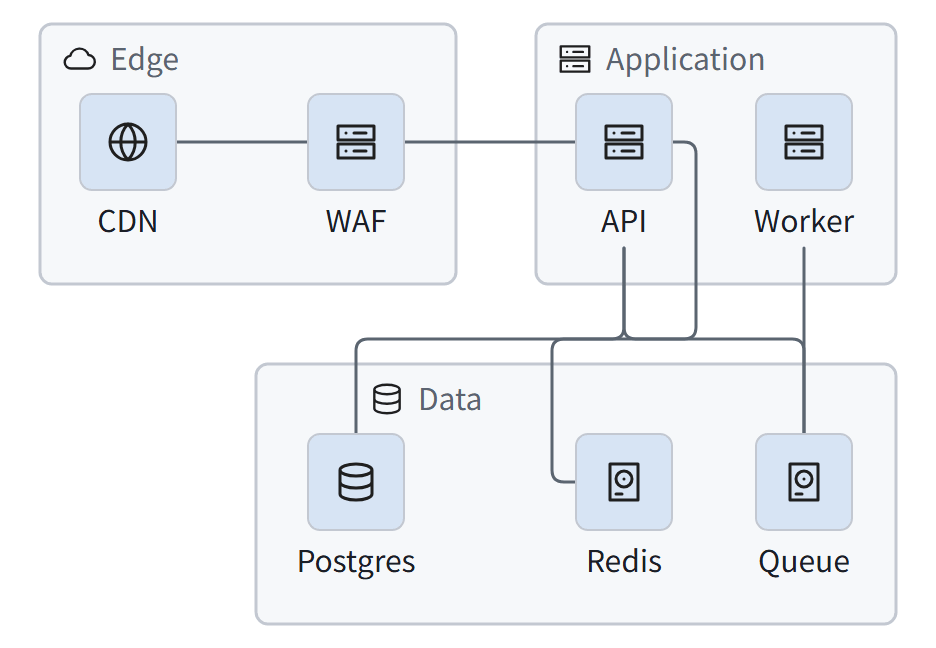 | 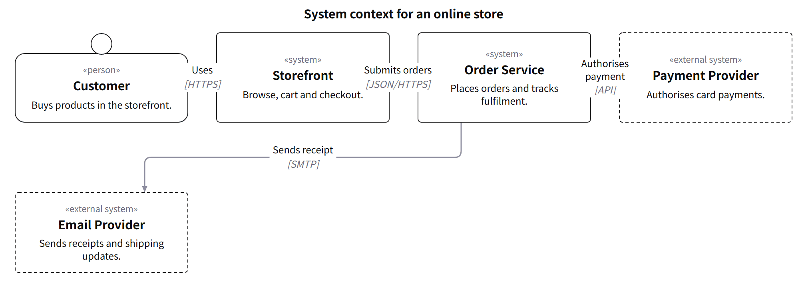 |

Both images are produced directly from the sources below:

```bash
mmdx arch.mmd -t tech -o architecture-beta.png --scale 2
mmdx c4.mmd -t openai -o c4-context.png --scale 2
```

## architecture-beta

`architecture-beta` describes boundaries with `group`, resources with `service`, and links with four-side ports (`L` `R` `T` `B`).

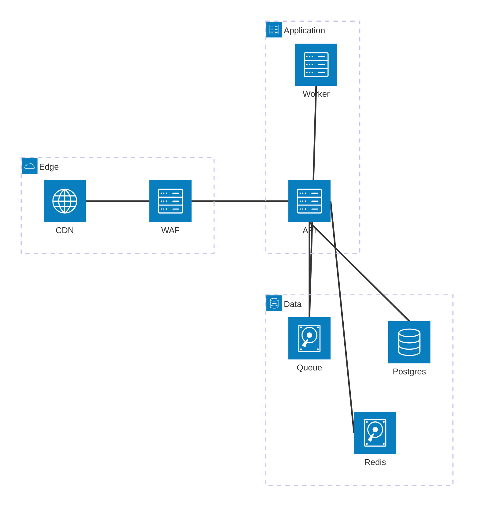

### Syntax

| Form | Meaning |
| --- | --- |
| `group id(icon)[Title]` | Declare a group; `in parent` nests it |
| `service id(icon)[Title] in group` | Declare a service inside a group |
| `junction id` | A routing junction for fan-in/fan-out |
| `a:R -- L:b` | Connect a's right side to b's left side; use `T/B` too |
| `a:R --> L:b` | Arrow syntax; Pele currently draws the edge without the arrowhead |
| `a{group}:R -- L:b{group}` | Route through group boundaries |

### Icons

The `(icon)` name can be a built-in Pele shape icon (`cloud`, `server`, `database`, `disk`, `internet`) or an Iconify icon:

```bash
mmdx arch.mmd --icon logos -o arch.png
```

```mermaid
architecture-beta
    service api(logos:aws-ec2)[API]
    service db(logos:aws-rds)[Database]
    api:R -- L:db
```

Built-in icons work offline. Iconify packs are fetched from unpkg on first use and cached in the system temp directory; pre-warm them once for fully offline delivery.

### When to use it

- Good: cloud service tiers, VPC/region/namespace boundaries, CI/CD pipelines, service-to-store dependencies.
- Poor fit: physical network topology with per-link bandwidth/protocol labels (use flowchart + subgraphs), decision flows (flowchart), or time-ordered interactions (`sequenceDiagram`).
- `architecture-beta` is still beta in Mermaid; verify complex nesting with `-f svg` before exporting the final PNG.

## C4

C4 encodes the roles of people, systems and external systems in the syntax, which makes it a better fit for context and container-level documentation than a plain flowchart.

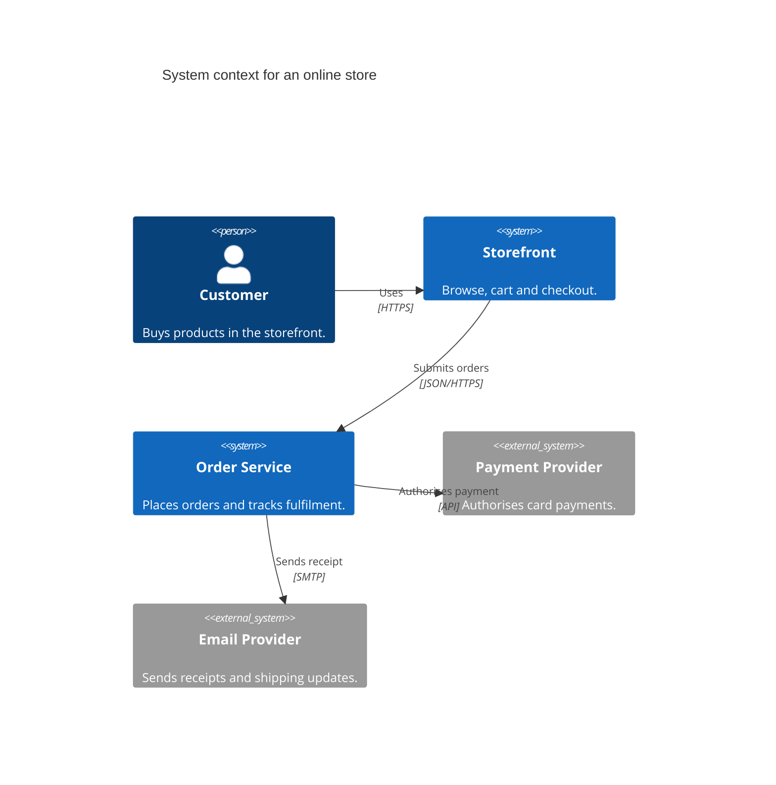

### Syntax

| Form | Meaning |
| --- | --- |
| `Person(id, "Name", "Description")` | User / role |
| `System(id, "Name", "Description")` | System in scope |
| `System_Ext(id, "Name", "Description")` | External system |
| `Rel(from, to, "Label", "Protocol")` | Relationship and protocol; protocol optional |
| `C4Container` / `C4Component` | Finer levels; verify Pele's layout with `-f svg` first |

C4 semantic colors come from the theme's `c4.*` tokens. Switching `-t openai`, `-t tech` or `-t zed` restyles the diagram without editing the source.

## Common Kubernetes diagrams

Kubernetes' official diagrams follow a stable pattern: control plane and worker nodes as separate panels, official English component names, one box per component, and edges that express communication. The two templates below use that pattern and a shared `classDef` palette for layer semantics; both render with `-t openai`.

### Template 1: cluster architecture

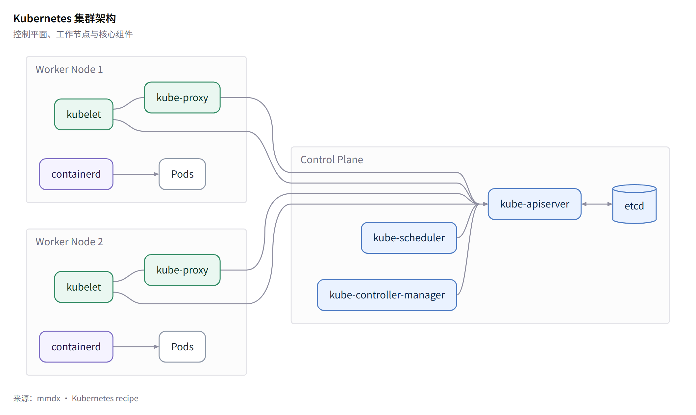

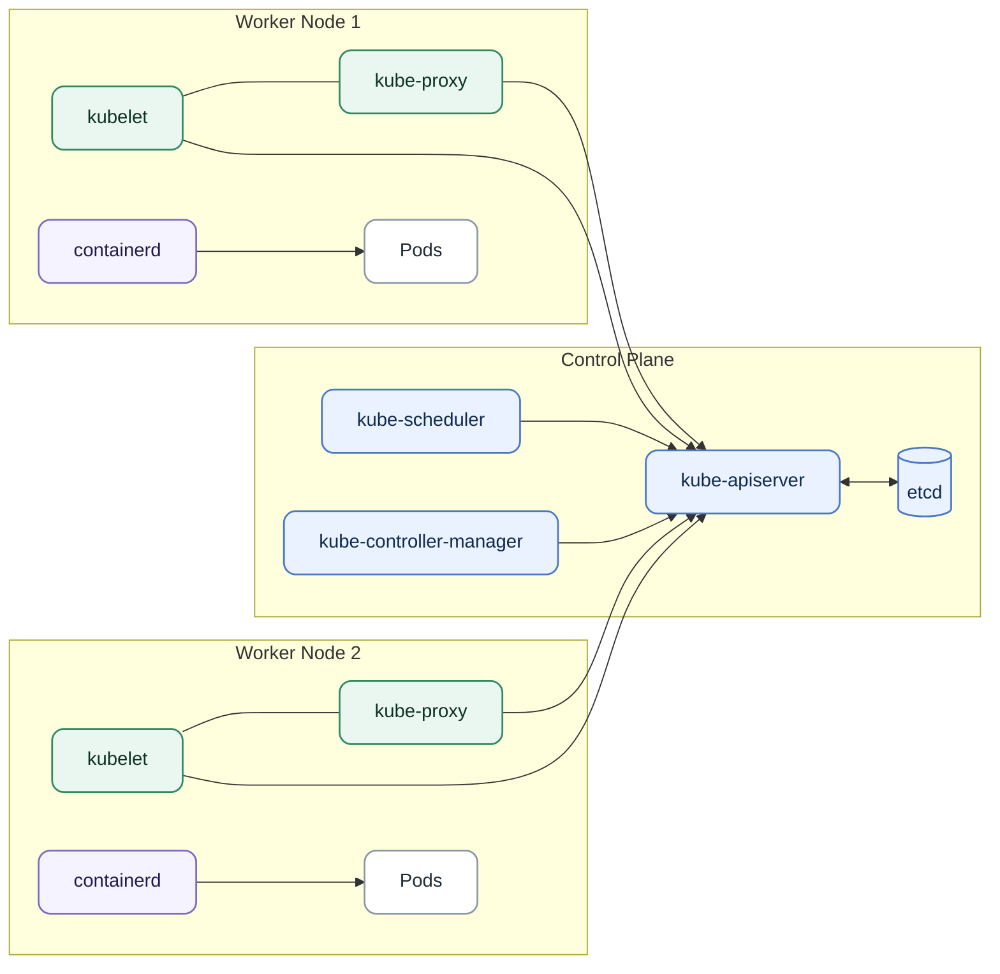

`flowchart LR` is the key to this template: workers sit on the left and the control plane on the right, so arrows from kubelet and kube-proxy run into the API server, and the control plane stays in a row. Since Pele 1.10.1, a subgraph whose nodes link outside it inherits its parent's direction, as in Mermaid, so the template leaves `direction` out of the groups and lets the parent `LR` do the work. Component names follow upstream documentation; replace `containerd` with the runtime the cluster actually uses. For a three-node cluster, copy the `Worker Node` subgraph. Above roughly 12 components, split the picture into cluster architecture and service path. The `flowchart-nodes` warning for exceeding the 9-node overview heuristic only appears in `--json.warnings`; it does not affect the image.

### Template 2: service access path

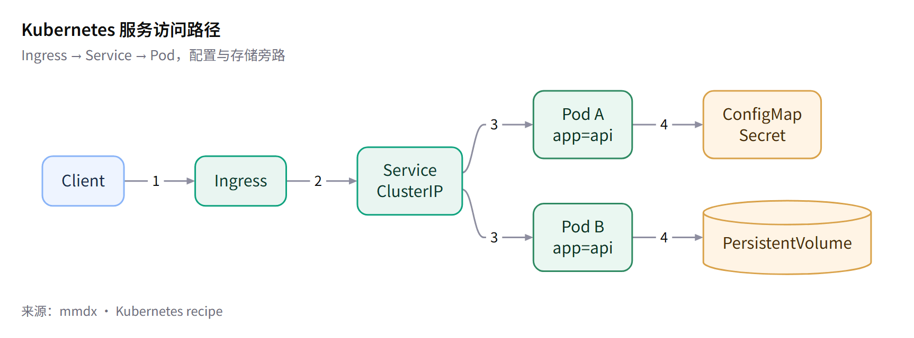

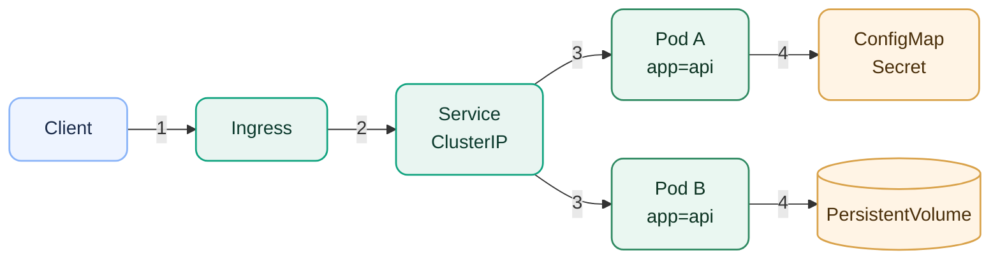

The real data plane is `Service → EndpointSlice → Pod`; the diagram keeps the `Service → Pod` simplification so the review page stays readable. `ConfigMap` / `Secret` and `PersistentVolume` sit on side branches, which keeps configuration and storage out of the request main path.

### K8s visual conventions

| Layer | Fill | Stroke | Components |
| --- | --- | --- | --- |
| Control plane | `#EAF2FF` | `#4A78C2` | kube-apiserver, etcd, kube-scheduler, kube-controller-manager |
| Worker node / service | `#EAF7F1` | `#2F8A62` | kubelet, kube-proxy, Pod, Service, Ingress |
| Container runtime | `#F5F3FF` | `#7C6BC4` | containerd, CRI-O |
| Configuration / storage | `#FFF4E5` | `#D9A24A` | ConfigMap, Secret, PersistentVolume |

- Use official English component names (`kube-apiserver`, `kube-controller-manager`); put Chinese in the title, subtitle and prose.
- Color carries layer semantics; all components in a layer share one `classDef`.
- Add optional components such as `cloud-controller-manager`, CoreDNS or an Ingress controller as needed, and keep each picture at 12 components or fewer.
- For icons, use `--icon logos` with `@{ icon: logos:kubernetes }`; official diagrams are box-first, so use icons only where they improve recognition.

```bash
mmdx k8s-cluster.mmd -t openai \
  --title "Kubernetes 集群架构" \
  --subtitle "控制平面、工作节点与核心组件" \
  --source "mmdx · Kubernetes recipe" \
  -o kubernetes-architecture.png --scale 2

mmdx k8s-service.mmd -t openai \
  --title "Kubernetes 服务访问路径" \
  --subtitle "Ingress → Service → Pod，配置与存储旁路" \
  -o kubernetes-service-path.png --scale 2
```

## Technical explainer style (OpenAI / ChatGPT family)

ChatGPT's common technical architecture explainers follow a stable layout: near-white canvas, ink text, mint accent, rounded cards, hairline borders, layer-based color, and numbered request paths. This section turns that layout into a reusable mmdx recipe using the `openai` theme and a fixed `classDef` palette. It is a layout convention, not an official OpenAI specification.

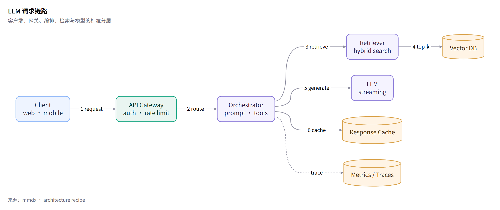

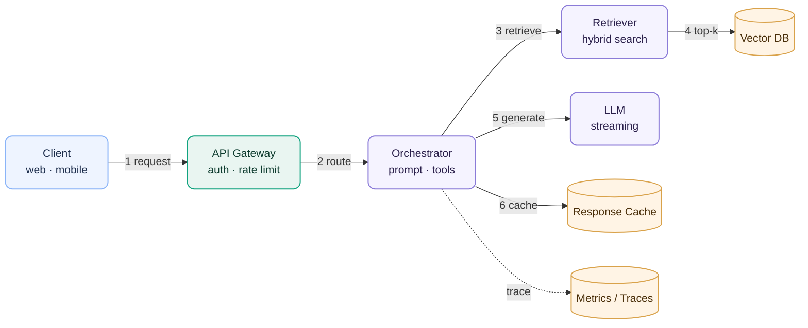

### Layer palette

| Layer | Fill | Stroke | Text | Class |
| --- | --- | --- | --- | --- |
| Client / entry | `#EEF4FF` | `#8AB4F8` | `#1A2B4A` | `client` |
| Gateway / boundary | `#E9F5F1` | `#10A37F` | `#0D3B2E` | `edge` |
| Service / compute | `#F5F3FF` | `#8B7BD8` | `#2A1F4A` | `service` |
| Data / state | `#FFF4E5` | `#D9A24A` | `#4A2F0A` | `data` |

### Layout rules

1. Use at most four layer colors; color maps to layer, and every node in a layer shares the same class.
2. Write each label as a name plus a one-line responsibility, separated by `<br/>`; keep it to two lines.
3. Number the request path with edge labels such as `-->|1 request|`; keep it to six steps. Use dotted edges (`-.->`) for async work, observability and side paths.
4. Set the figure title with `--title`, a one-line subtitle with `--subtitle`, and the origin with `--source`; all three appear in the PNG caption and metadata.
5. Keep the canvas near-white (`-t openai` uses `#FFFFFF`), with mint `#10A37F` as the only accent. Keep shadows, gradients and pseudo-3D effects off the nodes.
6. For a large system, split into a request path and a data/observability side path so each picture has one narrative focus.
7. To use a brand color, override `accent` with `--theme-js` and keep the `classDef` palette unchanged, so diagrams stay consistent across a document set.

```bash
mmdx tech-flow.mmd -t openai \
  --title "LLM 请求链路" \
  --subtitle "客户端、网关、编排、检索与模型的标准分层" \
  --source "mmdx · architecture recipe" \
  -o tech-architecture.png --scale 2
```

## Relation to D2 and PathVis

D2 excels at container-level `direction`/`near`/pinned positions and TALA's non-hierarchical layout. PathVis excels at turning traceroute data into a readable "you → hops → destinations" path. mmdx keeps one syntax and one layout engine, so professional diagrams take three routes:

1. **Structured service/resource diagrams**: `architecture-beta` or C4 through Pele.
2. **Fixed-naming and layer-based K8s / technical explainers**: flowchart + subgraphs + a fixed `classDef` layer palette.
3. **Network or path diagrams that need precise placement**: flowchart + subgraphs + `@{ icon: ... }`, then fine-tune anchors and routing in `mmdx edit`.

The research notes (D2 ELK/TALA/Dagre examples, shumoku, PathVis, nwdiag, KubeDiagrams and more) are in [research-domain-diagrams.md](research-domain-diagrams.md).

## Sources (architecture-beta / C4)

The complete Kubernetes and technical-explainer sources are in the sections above; the two original examples remain below as plain text for copy-paste.

### architecture-beta

```text
architecture-beta
    group edge(cloud)[Edge]
    group app(server)[Application]
    group data(database)[Data]

    service cdn(internet)[CDN] in edge
    service waf(server)[WAF] in edge
    service api(server)[API] in app
    service worker(server)[Worker] in app
    service db(database)[Postgres] in data
    service cache(disk)[Redis] in data
    service queue(disk)[Queue] in data

    cdn:R -- L:waf
    waf:R -- L:api
    api:B -- T:db
    api:R -- L:cache
    worker:B -- T:queue
    api:B -- T:queue
```

### C4

```text
C4Context
    title System context for an online store

    Person(customer, "Customer", "Buys products in the storefront.")
    System(storefront, "Storefront", "Browse, cart and checkout.")
    System(order, "Order Service", "Places orders and tracks fulfilment.")
    System_Ext(payment, "Payment Provider", "Authorises card payments.")
    System_Ext(email, "Email Provider", "Sends receipts and shipping updates.")

    Rel(customer, storefront, "Uses", "HTTPS")
    Rel(storefront, order, "Submits orders", "JSON/HTTPS")
    Rel(order, payment, "Authorises payment", "API")
    Rel(order, email, "Sends receipt", "SMTP")
```
