# 专业场景图：architecture-beta、C4、K8s 与技术解释图

> English: [ARCHITECTURE.en.md](ARCHITECTURE.en.md) · 主题与出图参数见 [HUMAN_GUIDE](HUMAN_GUIDE.md) · 图型索引见 [AGENT_GUIDE](AGENT_GUIDE.md)

mmdx 的渲染内核 Pele 已经能解析 Mermaid 的 `architecture-beta` 与 C4 图。它们适合“服务 / 资源 / 边界”清楚的系统图，不替代 flowchart：需要精确连线走线、判定分支或泳道时仍用 flowchart。本页同时给出 K8s 集群 / 服务路径与 ChatGPT 风技术解释图的可复用模板。

| architecture-beta | C4 Context |
| --- | --- |
| 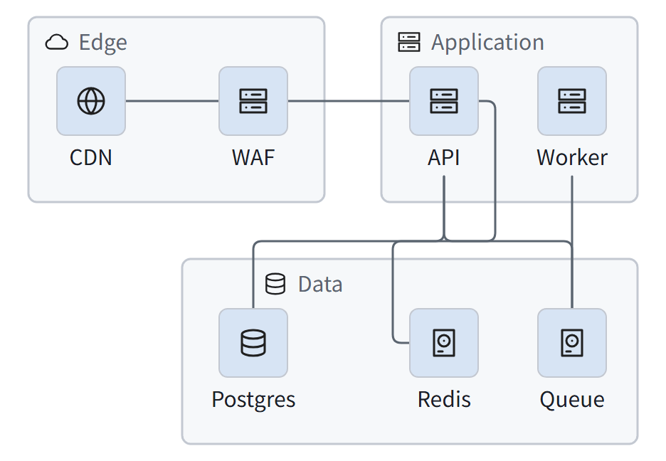 | 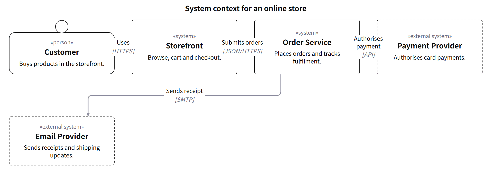 |

两张图分别由 [`tests` 同款源码](#示例源码) 直接生成：

```bash
mmdx arch.mmd -t tech -o architecture-beta.png --scale 2
mmdx c4.mmd -t openai -o c4-context.png --scale 2
```

## architecture-beta

`architecture-beta` 用 `group` / `service` / `junction` 描述边界与资源，连线用四边端口（`L` `R` `T` `B`）指定出入口。

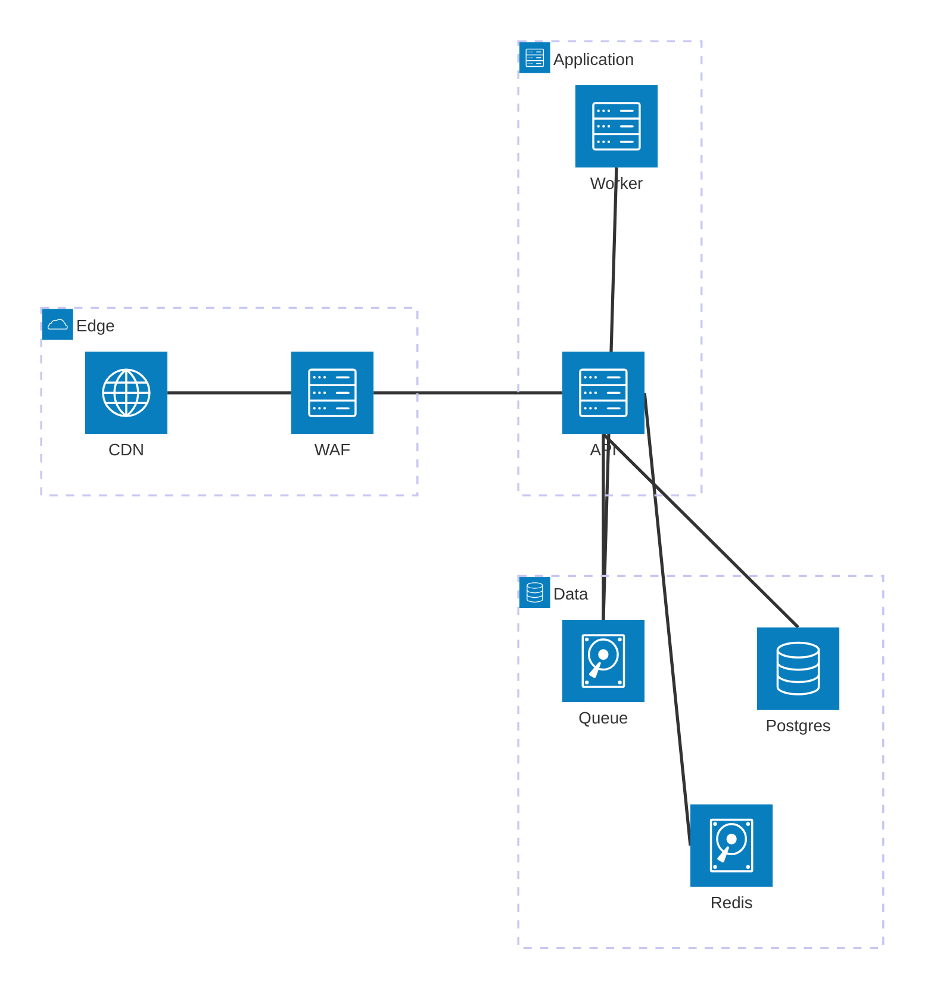

### 语法要点

| 写法 | 含义 |
| --- | --- |
| `group id(icon)[Title]` | 建一个组；`in parent` 可以嵌套 |
| `service id(icon)[Title] in group` | 建一个服务节点并放进组 |
| `junction id` | 建一个连线拐点，适合汇聚/分叉 |
| `a:R -- L:b` | 从 `a` 右边到 `b` 左边；端口可换 `T/B` |
| `a:R --> L:b` | 带箭头；当前 Pele 会画出连线，箭头端暂不绘制 |
| `a{group}:R -- L:b{group}` | 连线从组边界出入，适合跨边界链路 |

### 图标

`(icon)` 里的名字可以是用 Pele 内置的形状图标（`cloud` / `server` / `database` / `disk` / `internet`），也可以是 Iconify 图标：

```bash
mmdx arch.mmd --icon logos -o arch.png
```

```mermaid
architecture-beta
    service api(logos:aws-ec2)[API]
    service db(logos:aws-rds)[Database]
    api:R -- L:db
```

内置图标不联网；Iconify 包首次使用会从 unpkg 拉取并缓存到系统临时目录。需要完全离线交付时，先用一次把包缓存好，或只用内置图标。

### 适合与不适合

- 适合：云上服务分层、VPC/区域/命名空间边界、CI/CD 流水线、服务与数据存储的依赖关系。
- 不适合：需要逐条标注协议/带宽的物理网络拓扑（用 flowchart + 子图更可控）、需要判断分支的流程（用 flowchart）、需要时序的交互（用 `sequenceDiagram`）。
- `architecture-beta` 在 Mermaid 中仍是 beta；Pele 对它的支持以本页示例为准，复杂嵌套建议先 `-f svg` 检查再出 PNG。

## C4

C4 图把“人 / 系统 / 外部系统”的角色直接写进语法，比普通 flowchart 更适合系统上下文与容器级说明。

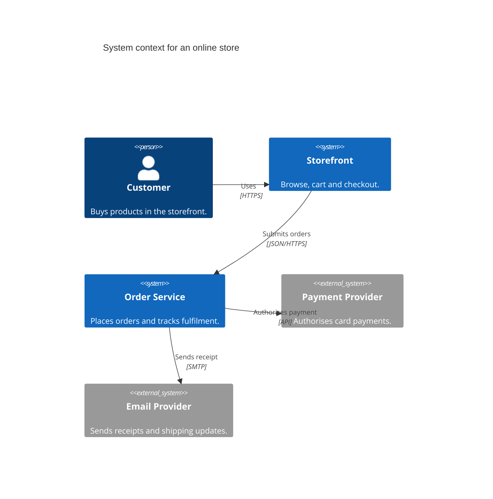

### 语法要点

| 写法 | 含义 |
| --- | --- |
| `Person(id, "Name", "Description")` | 使用者 / 角色 |
| `System(id, "Name", "Description")` | 当前系统 |
| `System_Ext(id, "Name", "Description")` | 外部系统 |
| `Rel(from, to, "Label", "Protocol")` | 关系与协议；协议可省略 |
| `C4Container` / `C4Component` | 更细的层级；先用 `-f svg` 验证 Pele 的布局 |

C4 的语义色由主题的 `c4.*` token 控制；换 `-t openai`、`-t tech` 或 `-t zed` 会一起换字色与填充，不需要改图。

## Kubernetes 常见示意图

K8s 官方文档的示意图有一套稳定写法：控制平面与工作节点分区、组件名保持官方英文、每个组件一个盒子、连线只表达通信关系。下面两套模板沿用这套写法，并用同一组 `classDef` 色板区分层级；主题统一用 `-t openai`。

### 模板一：集群架构

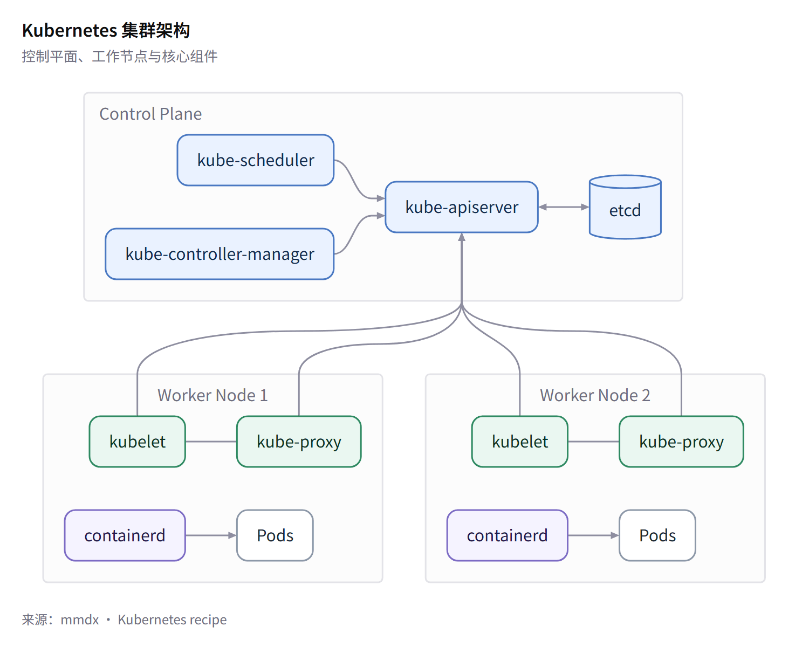

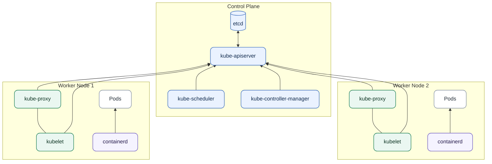

`flowchart BT` 是这套模板的关键：API server 作为边的目标放在上方，kubelet / kube-proxy 作为来源放在下方，箭头自然指向 API server。组内的 `direction LR` 让同一层的组件横排。组件名遵循上游文档；`containerd` 可以换成集群实际使用的容器运行时。三节点集群复制一份 `Worker Node` 子图即可；组件超过 12 个时，建议拆成“集群架构”和“服务访问路径”两张图。整图超过概览 9 节点的 `flowchart-nodes` 提示只进 `--json.warnings`，不影响出图。

### 模板二：服务访问路径

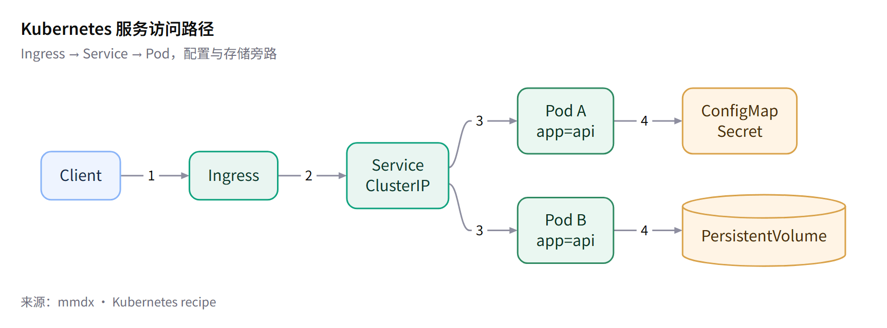

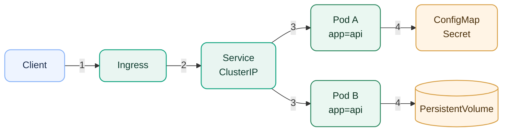

真实数据面是 `Service → EndpointSlice → Pod`；示意图保留 `Service → Pod` 的简化写法，便于在评审页上读。`ConfigMap` / `Secret` 与 `PersistentVolume` 画旁路，避免把配置和存储混进请求主链。

### K8s 视觉约定

| 层级 | 填充 | 描边 | 适用组件 |
| --- | --- | --- | --- |
| 控制平面 | `#EAF2FF` | `#4A78C2` | kube-apiserver、etcd、kube-scheduler、kube-controller-manager |
| 工作节点 / 服务 | `#EAF7F1` | `#2F8A62` | kubelet、kube-proxy、Pod、Service、Ingress |
| 容器运行时 | `#F5F3FF` | `#7C6BC4` | containerd、CRI-O |
| 配置 / 存储 | `#FFF4E5` | `#D9A24A` | ConfigMap、Secret、PersistentVolume |

- 组件名用官方英文（`kube-apiserver`、`kube-controller-manager`），标题、副标题和说明用中文。
- 颜色只承担层级；同一层级的组件用同一个 `classDef`。
- `cloud-controller-manager`、CoreDNS、Ingress Controller 等可选组件按需加入，保持每张图 ≤12 个组件。
- 需要图标时用 `--icon logos` + `@{ icon: logos:kubernetes }`；官方图以盒子为主，图标只放在能增加识别度的组件上。

```bash
mmdx k8s-cluster.mmd -t openai \
  --title "Kubernetes 集群架构" \
  --subtitle "控制平面、工作节点与核心组件" \
  --source "mmdx · Kubernetes recipe" \
  -o kubernetes-architecture.png --scale 2

mmdx k8s-service.mmd -t openai \
  --title "Kubernetes 服务访问路径" \
  --subtitle "Ingress → Service → Pod，配置与存储旁路" \
  -o kubernetes-service-path.png --scale 2
```

## 技术解释图风格（OpenAI / ChatGPT 系）

ChatGPT 常见的技术架构解释图有一套稳定版式：近白底、墨色文字、薄荷绿强调、圆角卡片、细边框、按层着色、请求链用编号标注。这里把它整理成 mmdx 的可复用版式，主题用 `openai`，层色用 `classDef` 固定下来。它是版式约定，不是 OpenAI 官方规范。

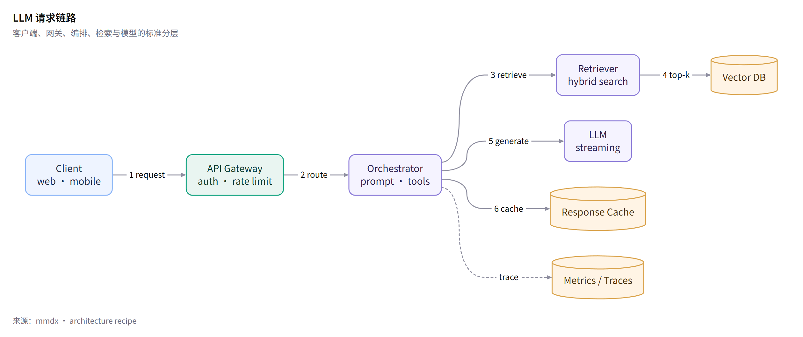

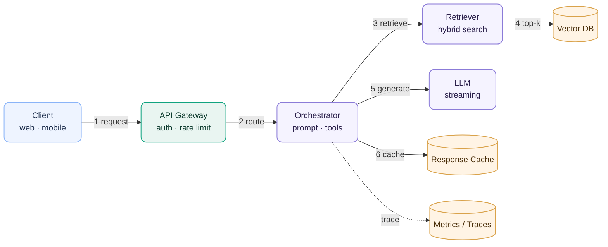

### 层色板

| 层级 | 填充 | 描边 | 文字 | class |
| --- | --- | --- | --- | --- |
| 客户端 / 入口 | `#EEF4FF` | `#8AB4F8` | `#1A2B4A` | `client` |
| 网关 / 边界 | `#E9F5F1` | `#10A37F` | `#0D3B2E` | `edge` |
| 服务 / 计算 | `#F5F3FF` | `#8B7BD8` | `#2A1F4A` | `service` |
| 数据 / 状态 | `#FFF4E5` | `#D9A24A` | `#4A2F0A` | `data` |

### 版式规则

1. 层色不超过四种；颜色只区分层级，同一层所有节点同色。
2. 节点标签写成“名称 + 一行职责”，用 `<br/>` 换行；标签控制在两行内。
3. 请求链用 `-->|1 request|` 这种编号边标签，步骤 ≤6；异步、观测、旁路用虚线 `-.->`。
4. 图题用 `--title`，一句副标题用 `--subtitle`，来源用 `--source`；三者会进 PNG 图题层与元信息。
5. 画布保持近白底（`-t openai` 默认 `#FFFFFF`），强调色只用薄荷绿 `#10A37F`；不要在节点上叠加阴影、渐变或伪 3D。
6. 组件多时先拆成“请求主链”和“数据 / 观测旁路”两张图，保持每张图一个叙事焦点。
7. 需要品牌色时用 `--theme-js` 覆盖 `accent`，`classDef` 色板保持不变，避免每个图各调一套。

```bash
mmdx tech-flow.mmd -t openai \
  --title "LLM 请求链路" \
  --subtitle "客户端、网关、编排、检索与模型的标准分层" \
  --source "mmdx · architecture recipe" \
  -o tech-architecture.png --scale 2
```

## 与 D2 / PathVis 类工具的取舍

D2 的强项是容器级 `direction` / `near` / 固定坐标与 TALA 的非层级布局；PathVis 的强项是把 traceroute 的“你 → 中间跳 → 目标”画成可读路径。mmdx 不引入第二套语法或布局引擎，专业场景走三条路：

1. **结构清楚的服务/资源图**：`architecture-beta` / C4，直接走 Pele。
2. **命名与分层固定的 K8s / 技术解释图**：flowchart + 子图 + 固定 `classDef` 层色模板。
3. **需要精确认知位置的网络或路径图**：flowchart + 子图 + `@{ icon: ... }`，必要时用 `mmdx edit` 手工微调锚点与走线。

调研记录（D2 ELK/TALA/Dagre 示例、shumoku、PathVis、nwdiag、KubeDiagrams 等）见 [research-domain-diagrams.md](research-domain-diagrams.md)。

## 示例源码（architecture-beta / C4）

Kubernetes 与技术解释图的完整源码见上文各节；下面保留前两套示例的纯文本版本，方便直接复制。

### architecture-beta

```text
architecture-beta
    group edge(cloud)[Edge]
    group app(server)[Application]
    group data(database)[Data]

    service cdn(internet)[CDN] in edge
    service waf(server)[WAF] in edge
    service api(server)[API] in app
    service worker(server)[Worker] in app
    service db(database)[Postgres] in data
    service cache(disk)[Redis] in data
    service queue(disk)[Queue] in data

    cdn:R -- L:waf
    waf:R -- L:api
    api:B -- T:db
    api:R -- L:cache
    worker:B -- T:queue
    api:B -- T:queue
```

### C4

```text
C4Context
    title System context for an online store

    Person(customer, "Customer", "Buys products in the storefront.")
    System(storefront, "Storefront", "Browse, cart and checkout.")
    System(order, "Order Service", "Places orders and tracks fulfilment.")
    System_Ext(payment, "Payment Provider", "Authorises card payments.")
    System_Ext(email, "Email Provider", "Sends receipts and shipping updates.")

    Rel(customer, storefront, "Uses", "HTTPS")
    Rel(storefront, order, "Submits orders", "JSON/HTTPS")
    Rel(order, payment, "Authorises payment", "API")
    Rel(order, email, "Sends receipt", "SMTP")
```
