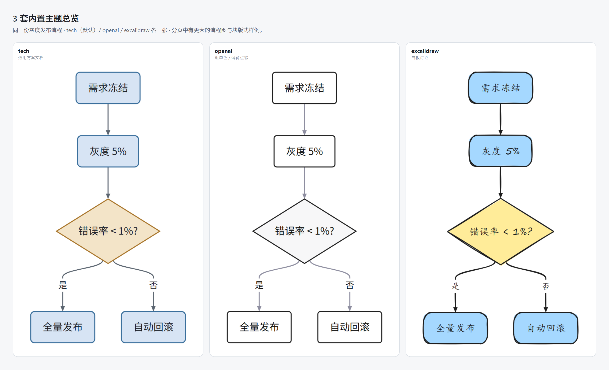
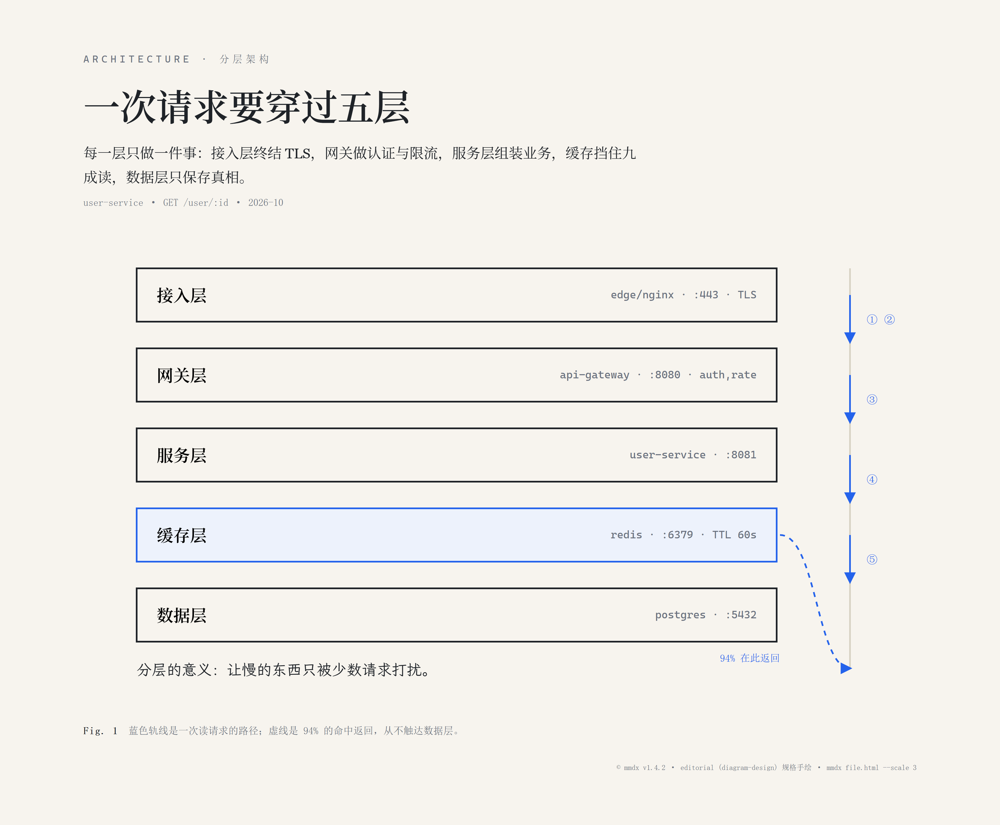

> English · [中文](GALLERY.md)

# Style gallery

One case, split into one page per style. The overview keeps a single flowchart for a quick comparison; each new theme adds a page with the same structure instead of growing this page.

[](gallery/overview.png)

## All 3 themes

One flow per built-in theme; use this for the overall comparison, then open the style pages for block layouts:

[](gallery/all-themes-overview.png)

## HTML scenario templates

The two imported HTML scenarios now have cross-style galleries: the report card (OpenAI editorial skill) and the info card (qiaomu info-card skill).

| Report card (3 themes) | Info card (standalone skill) |
| --- | --- |
| [](gallery/html-skills.en.md) | [](gallery/card-tones.en.md) |

Full comparison: [Two HTML scenario templates](gallery/html-skills.en.md).

## Hand-drawn HTML templates (v1.4.2)

The previous tag used the `editorial` and `visual-explainer` hand-drawn HTML skills. They are not v2 theme presets; see [hand-drawn HTML templates](gallery/vendored-html.en.md) for the originals and the closest current presets.

| editorial | visual-explainer |
| --- | --- |
| [](gallery/vendored-html.en.md) | [](gallery/vendored-html.en.md) |

## The case

“Gray release retrospective”: the workflow, metrics, operating rules, and follow-ups after one deployment. It combines a flowchart with three office blocks and stays industry-neutral, so the comparison is about layout and palette.

Source: [examples/gallery/release-review.md](../examples/gallery/release-review.md). The overview uses a compact top-down version so labels stay readable at README width; the style pages show the full flowchart and all three blocks.

## Style index

Pick the scenario from the “Use it for” column, then check the look. `tone` applies to block pages and info cards only.

| Style | Use it for | Look | Full comparison |
| --- | --- | --- | --- |
| `tech` (default) | Design docs, weekly reports, general delivery | Blue / amber / green shape coding, 1.5px strokes, highest density | [tech](gallery/tech.en.md) |
| `openai` | External reports, engineering docs, minimal READMEs | White, ink, mint accent, hairline borders; shapes differ only by thin borders | [openai](gallery/openai.en.md) |
| `excalidraw` | Whiteboard sessions, brainstorming, informal sharing | Pastel fills with rough ink strokes, whiteboard cards, Kai fallback for Chinese | [excalidraw](gallery/excalidraw.en.md) |
| HTML report card / info card | The two imported HTML scenarios across themes | Same content; theme and `--tone` control palette and structure | [html-skills](gallery/html-skills.en.md) |
| Hand-drawn HTML (v1.4.2) | editorial covers/illustrations; visual-explainer explainers/recaps | Hand-written HTML + SVG, paper/ink/blue; not a theme preset | [vendored-html](gallery/vendored-html.en.md) |

All three themes consume the same Markdown: same diagram, same `kpi` / `card` / `table` fences, only `-t` changes. `--brand` overrides the accent; the theme keeps its shape coding.

The two HTML scenarios are compared in [html-skills](gallery/html-skills.en.md); the three info-card tones are in [card tones](gallery/card-tones.en.md).

The overview stays on these three built-in themes. A new theme adds a page and an index row; it does not add more images to the overview.

## Reproduce

```bash
node --experimental-transform-types --no-warnings scripts/make-gallery.ts
```

The script writes the per-theme scene pages, the report card and info card, 3 info-card tones, and both overview strips. `vendored-*.png` are the original v1.4.2 hand-drawn HTML samples.

Render one scene yourself:

```bash
mmdx examples/gallery/release-review.md -t openai -o out/
mmdx examples/gallery/release-review.md -t excalidraw --style-fill hachure -o out/
```

## Related

- [Theming](HUMAN_GUIDE.en.md#theming)
- [Extension blocks](EXTENSIONS.en.md)
- [Style port decisions and implementation notes](STYLE_PORTS.md)
