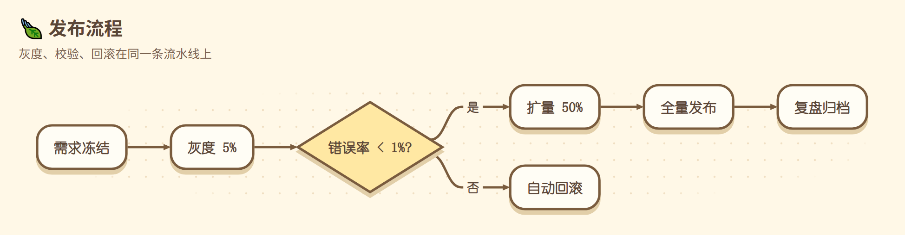
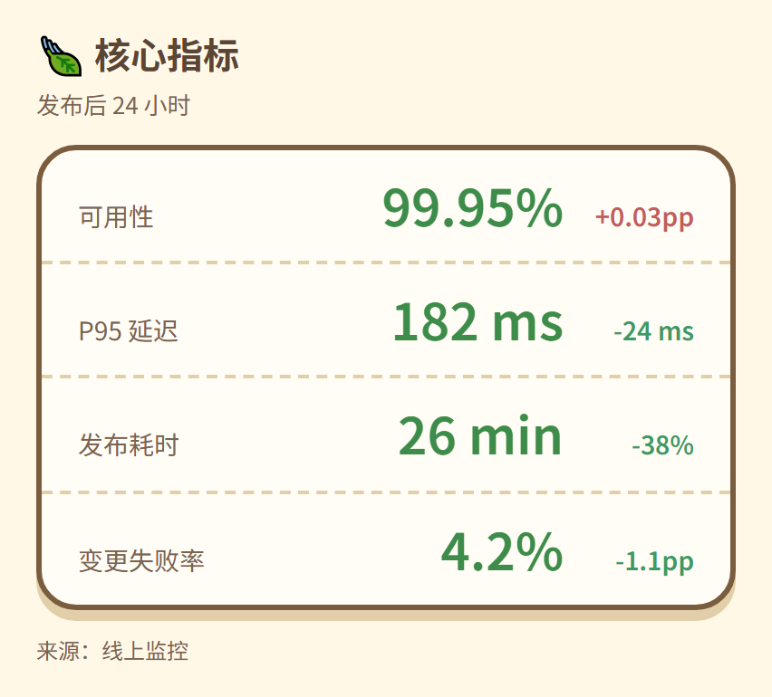
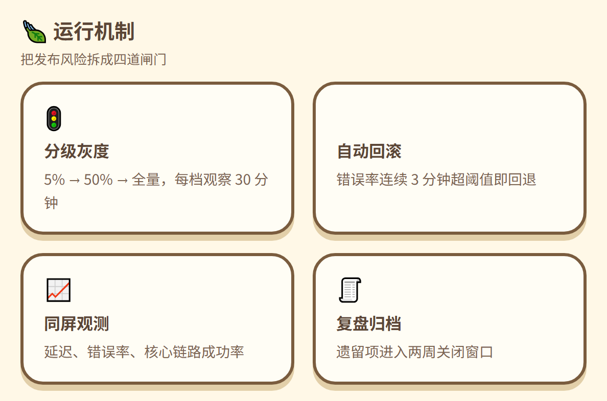
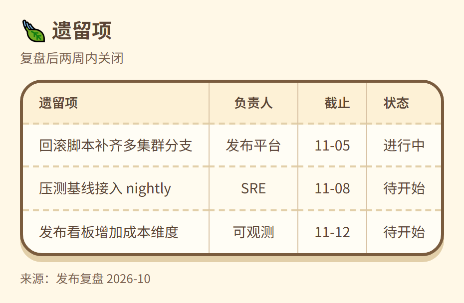

> English · [中文](acnh.md) · [Back to gallery](../GALLERY.en.md)

# acnh

Animal Crossing: cream paper (`#FFF8E7` with a dotted grid), thick brown outlines (`#7A5C3E`, 2.6px), hard offset sticker shadows (`0 5px 0 #E2CFA9`), rounded type and pill labels; 16px radii. Built for sticker-style weekly updates, team boards, and casual reports.

This is the ACNH prototype from `docs/STYLE_PORTS.md` — cancelled during research — rebuilt for real: the palette and block layout come from the prototype CSS in `.handoff/style-ports-prototypes/`, and the diagram side gained the dotted paper and the sticker shadow. Both prototype blockers are gone: the flatten pass now bakes CSS `filter` (so the sticker shadow reaches the SVG), and block pages get panels, radii, thick borders, dashed separators and pills through `theme.blockCss`.

The font stack starts with `ZCOOL KuaiLe` (Chinese) and `Baloo 2` (Latin) and falls back to system rounded faces (YouYuan / Segoe Print) when they are not bundled; font subsetting is still open.

## Flowchart

## KPI

## Cards

## Table

## Related

- [Theme customisation](../HUMAN_GUIDE.en.md#theme-customisation)
- [Extension blocks](../EXTENSIONS.en.md)
