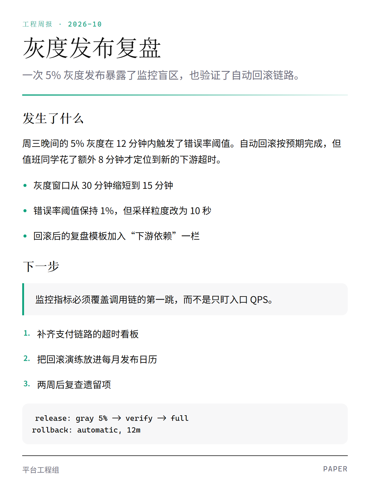
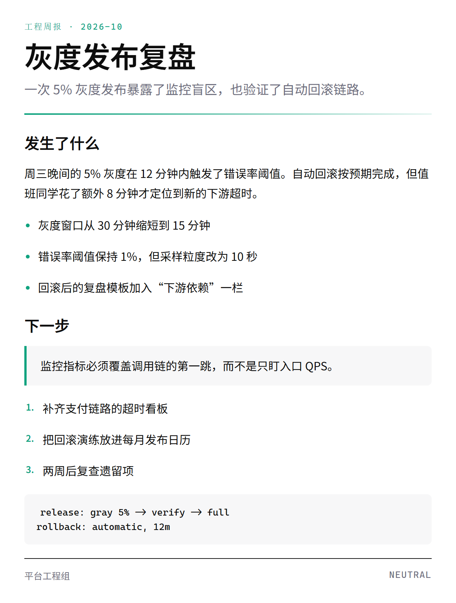
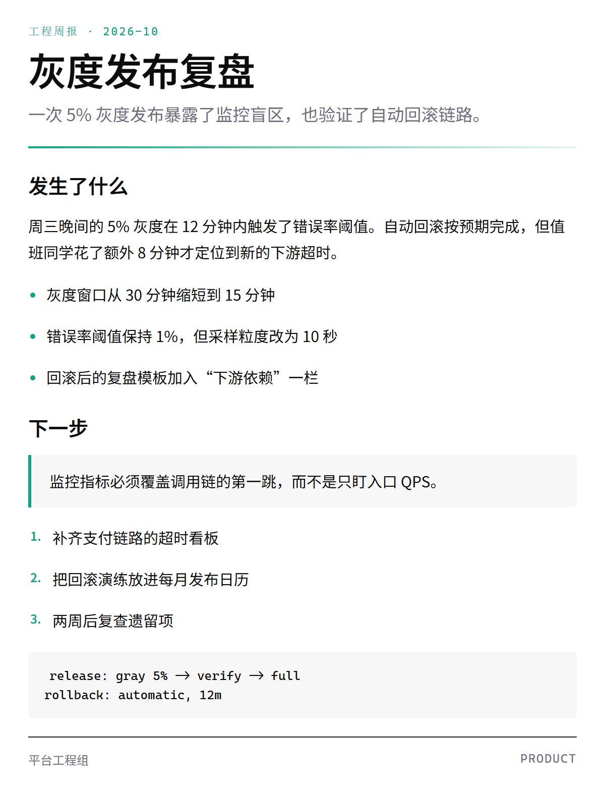

> [中文](card-tones.md) · English

# Info card: one template, three tones

`mmdx card` turns Markdown or a web article into an info card. `--theme` picks the palette; `--tone` picks the structure: radius, shadow, display type and table-header treatment.
Info cards are a standalone skill: [`info-card-designer`](../../skill/info-card-designer/SKILL.md) — URL/text → magazine HTML → PNG, 480/600/900 widths, auto-split above 1200px.


All three images use the same case and the same `openai` palette; only `--tone` changes:

## `paper` — report

Serif headings, 16px radii, generous padding. Suited to print, long summaries and external reports.



## `neutral` — document (default)

Sans headings, 10px radii, no shadow. Suited to engineering docs and knowledge bases.



## `product` — product UI

6px radii, subtle shadow, tight padding. Suited to release notes and dashboard sidebars.



## Commands

```bash
mmdx card --in examples/gallery/info-card.md -t openai --tone paper -o card-paper.png
mmdx card --in examples/gallery/info-card.md -t openai --tone neutral -o card-neutral.png
mmdx card --in examples/gallery/info-card.md -t openai --tone product -o card-product.png
```

[Back to gallery](../GALLERY.en.md) · [openai style](openai.en.md)
