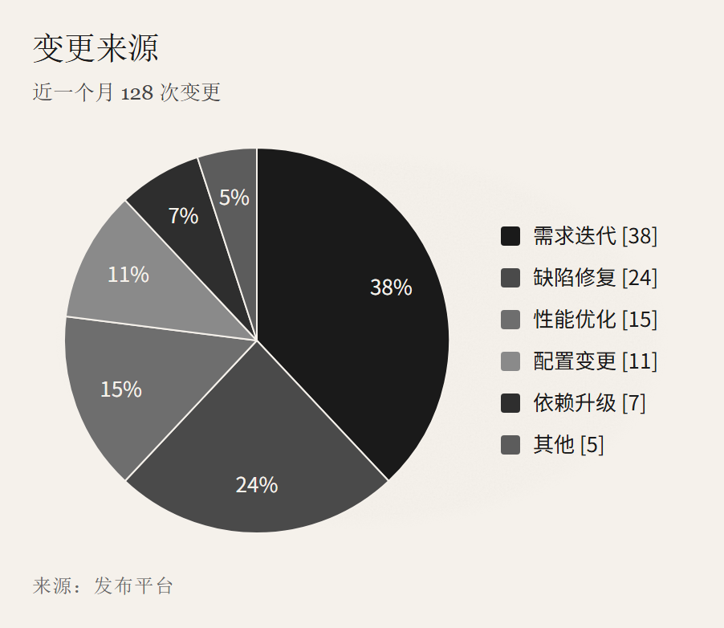

> English · [中文](epaper.md) · [Back to gallery](../GALLERY.en.md)

# epaper

E-ink, taken from [E-Ink / Paper (ui-ux-pro-max #56)](https://jacky0328.github.io/ui-ux-pro-max-web/styles/56-eink-paper.html): `#F5F1EB` stock with a paper grain (`feTurbulence`, 5% strength), `#1A1A1A` hairline strokes (1.1px), square corners, no shadow, no accent colour. Built for black-and-white print, e-reader reading, and compliance or audit documents.

Shape families stop relying on hue and use grey levels instead: process white, decision `#EDE9E2`, state `#E4E0D8`, store and cluster on the page stock. The four forms differ in shape as well (rect / diamond / stadium / cylinder), so nothing is lost in greyscale print or for a colour-blind reader.

Block pages use the same sheet: paper background with the same grain, transparent cards with a 1px ink border, square corners, serif body, uppercase monospace headers, and 1px light row rules (the header rule is ink).

## Flowchart

## Pie

## KPI

## Cards

## Table

## Related

- [Theming](../HUMAN_GUIDE.en.md#theming)
- [Extension blocks](../EXTENSIONS.en.md)
