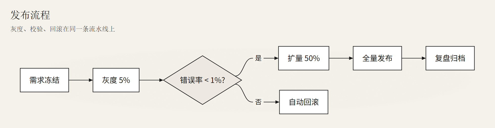
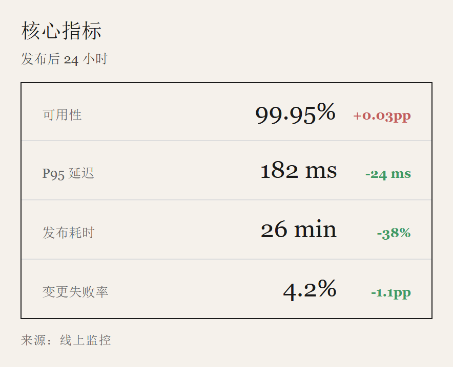
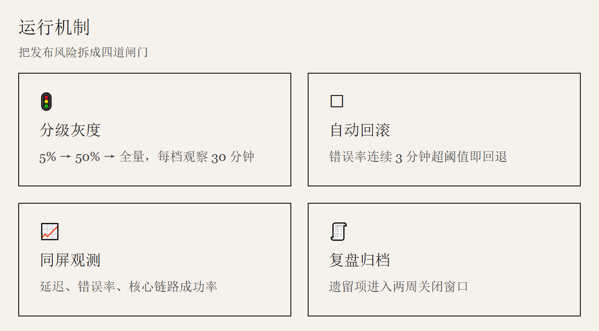
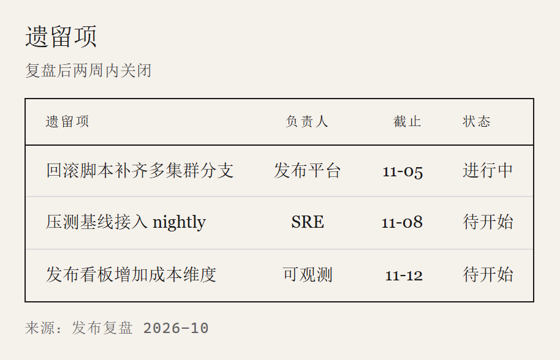

> [English](epaper.en.md) · 中文 · [返回画廊总览](../GALLERY.md)

# epaper

电子纸 / 墨水屏，取自 [E-Ink / Paper（ui-ux-pro-max #56）](https://jacky0328.github.io/ui-ux-pro-max-web/styles/56-eink-paper.html)：`#F5F1EB` 纸底 + 纸纹颗粒（`feTurbulence`，5% 强度）+ `#1A1A1A` 发丝黑描边（1.1px）、直角、无阴影、无强调色。适合黑白打印、墨水屏阅读、合规与审计文档。

形状族不再靠色相区分，改用灰阶：流程白、判定 `#EDE9E2`、状态 `#E4E0D8`、存储与分组用纸底；四个族的形状本身也不同（矩形 / 菱形 / 胶囊 / 圆柱），所以灰度打印、色盲读者都不会丢信息。

块页跟着同一套纸：纸底 + 同一张纸纹贴图、透明卡片 + 1px 墨线、直角、衬线正文、等宽大写小字表头、行间 1px 浅灰线（表头线是墨色）。

## 流程图

## KPI

## 卡片

## 表格

## 相关

- [主题定制](../HUMAN_GUIDE.md#主题定制)
- [扩展块图鉴](../EXTENSIONS.md)
