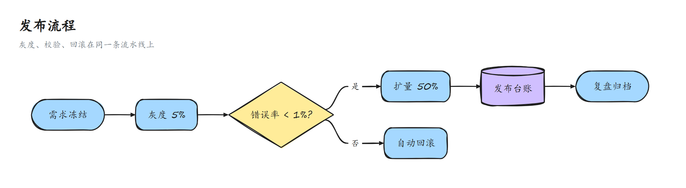
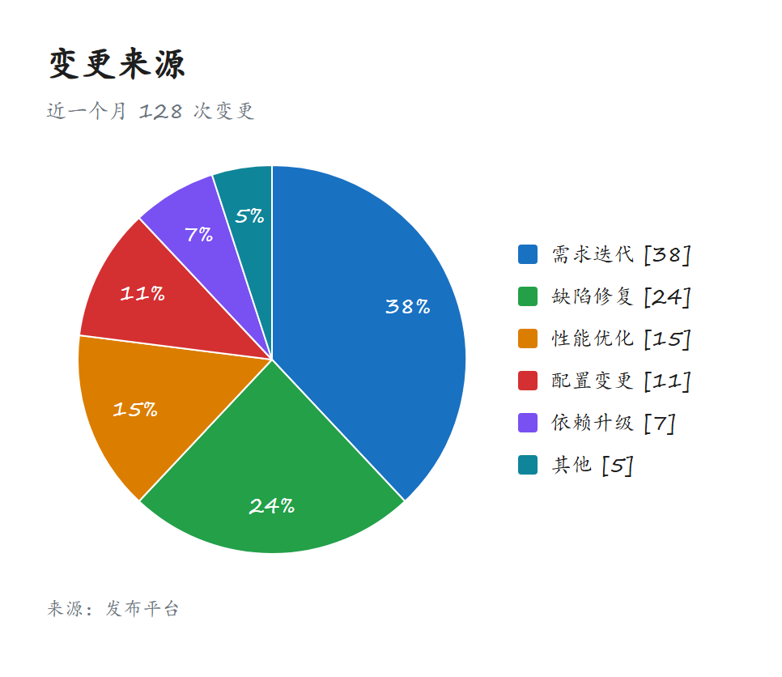
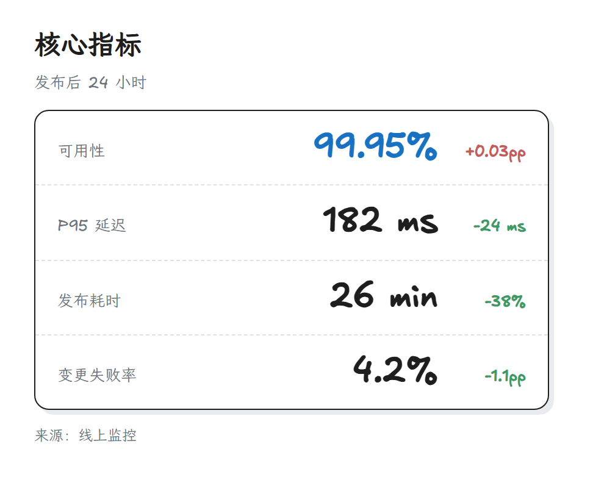
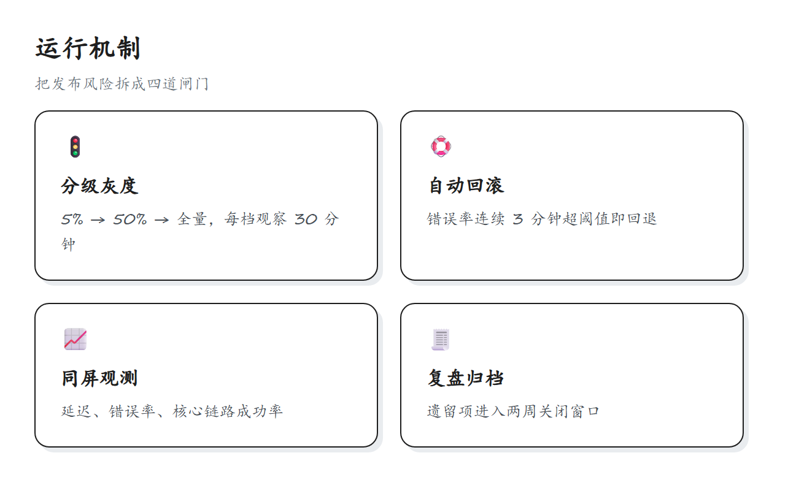
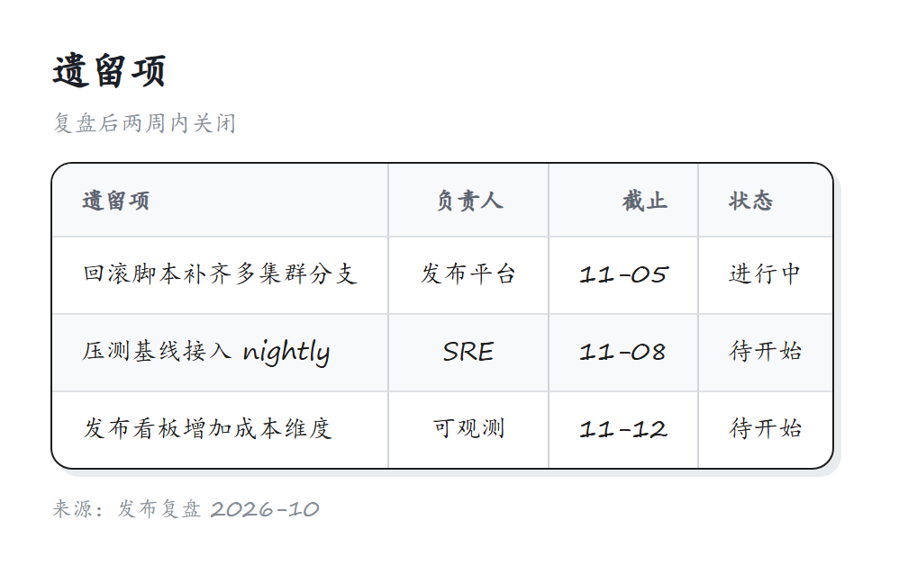

> [English](excalidraw.en.md) · 中文 · [返回画廊总览](../GALLERY.md)

# excalidraw

手绘风：rough.js 给 Pele 输出的节点和连线加重绘制的抖动，填色保持 Excalidraw 的粉彩。默认实心填色，投影和缩略图更干净；需要斜线填色时加 `--style-fill hachure`。

## 流程图

## 饼图

## KPI

## 卡片

## 表格

## 相关

- [主题定制](../HUMAN_GUIDE.md#主题定制)
- [扩展块图鉴](../EXTENSIONS.md)
