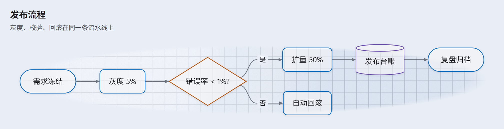
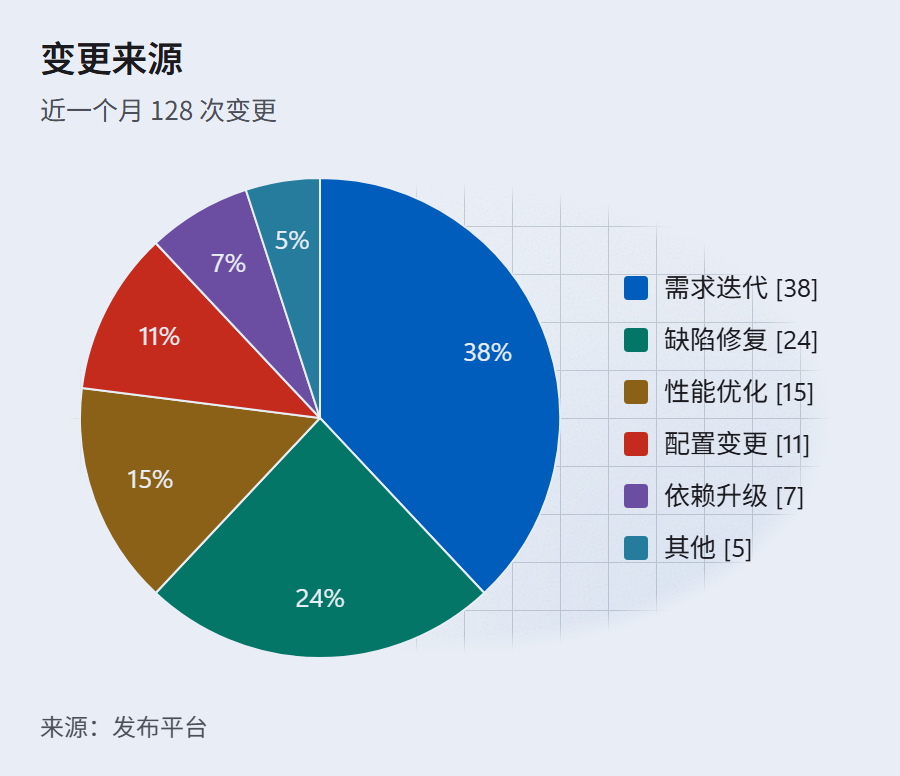
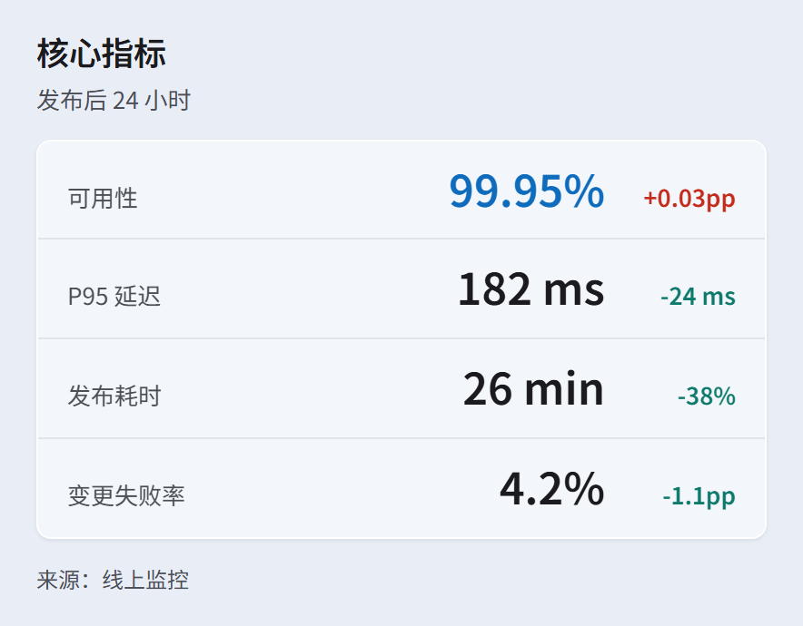
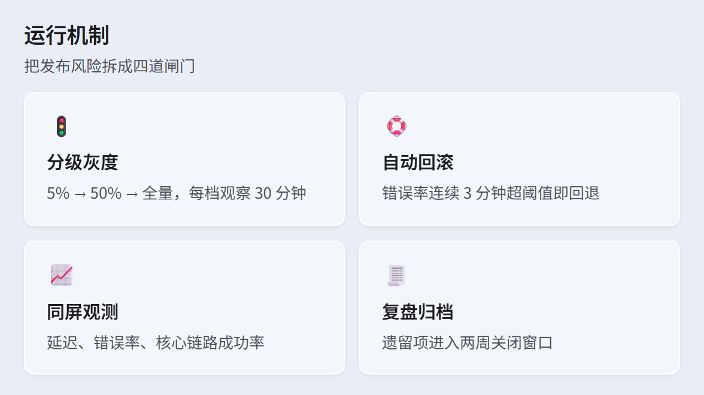
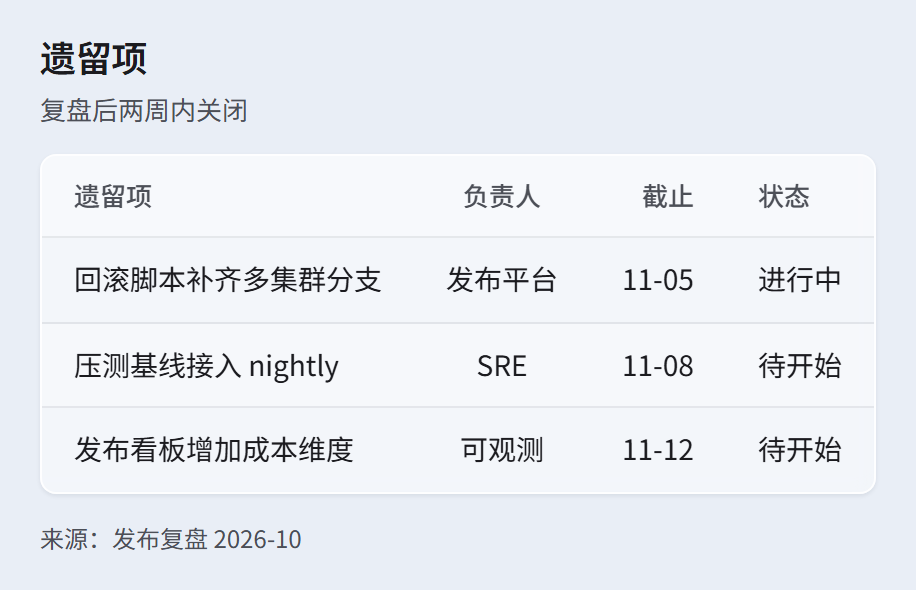

> English · [中文](glass.md) · [Back to gallery](../GALLERY.en.md)

# glass

Fluent acrylic glass: pale blue-grey canvas (`#E9EEF6`), 24px ruling, one translucent white sheet (0.16) with fine grain (10%) over it, panels at `rgba(255,255,255,.45)` with 8px radii, a light rim and a soft shadow; the accent is Fluent blue `#0F6CBD`. Use it for glass covers, modern product reviews, anything that wants material depth.

The acrylic is layered the way Fluent specifies it: base → blurred tint (soft focus) → ruling → translucent white sheet → grain. The ruling sits under the sheet, so it shows through the panels — the clearest glass cue there is. Chromium does not render `backdrop-filter` on SVG shapes, so the blur lives on the backdrop and the panels stay crisp. Block pages are HTML, where `backdrop-filter: blur(5px)` is real frosted glass; the blur stays light on purpose, since a 24px ruling smears into one flat tone under a heavy one.

The style paints its own backdrop (`<g class="mmdx-backdrop">`) and the PNG is captured full-bleed rather than cropped to the ink. With `--background transparent` no backdrop is drawn.

## Flowchart

## Pie

## KPI

## Cards

## Table

## Related

- [Theming](../HUMAN_GUIDE.en.md#theming)
- [Extension blocks](../EXTENSIONS.en.md)
