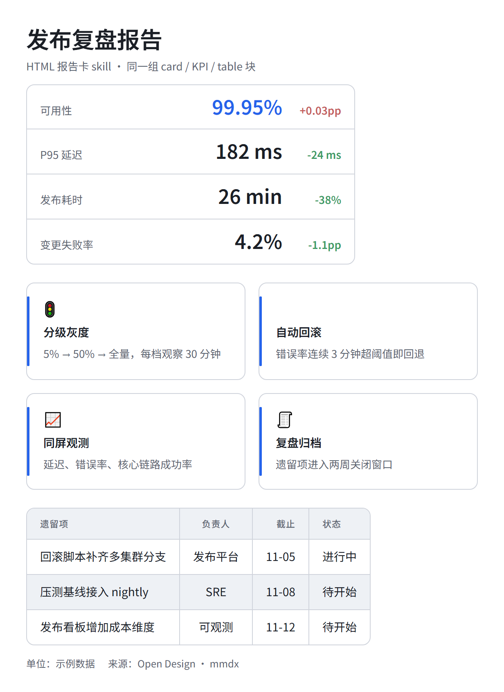
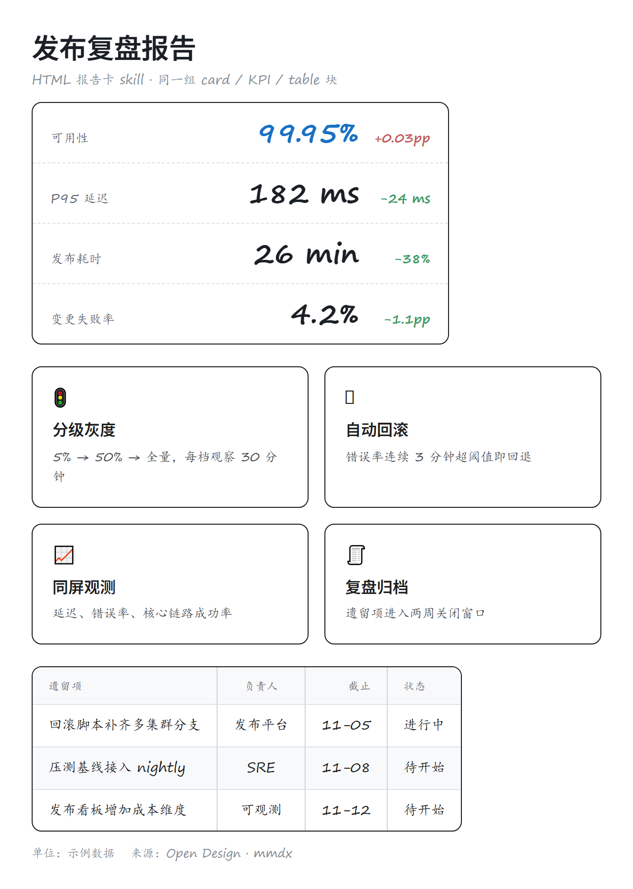

> [中文](html-skills.md) · English

# HTML report card

Open Design's OpenAI editorial skill: assemble `card` / `kpi` / `table` fences into a one-page report card. Same blocks, same content; only the theme changes. Info cards are a separate skill ([info-card-designer](../../skill/info-card-designer/SKILL.md)), so this page stays focused.

## `tech` + `neutral`

Blue / amber / green shape coding, 1.5px strokes; the report card uses the shared block layout and is the densest of the three.



## `openai` + `neutral`

White, ink, mint accent, hairline borders; shapes differ only by thin borders. Closest to the restrained feel of the imported skill.


## `excalidraw` + `neutral`

Pastel fills with rough ink strokes, whiteboard cards, handwriting fallback; suited to informal sharing.



## Reproduce

```bash
mmdx examples/gallery/release-review.md -t openai --tone neutral -o out/report.png
```

Info cards (URL/text → magazine card) use the standalone skill:

```bash
mmdx card --in note.md -t openai --tone paper -o card.png
```

See [info-card-designer](../../skill/info-card-designer/SKILL.md) and [info-card tones](card-tones.en.md).

[Back to gallery](../GALLERY.en.md) · [openai style](openai.en.md) · [excalidraw style](excalidraw.en.md)
