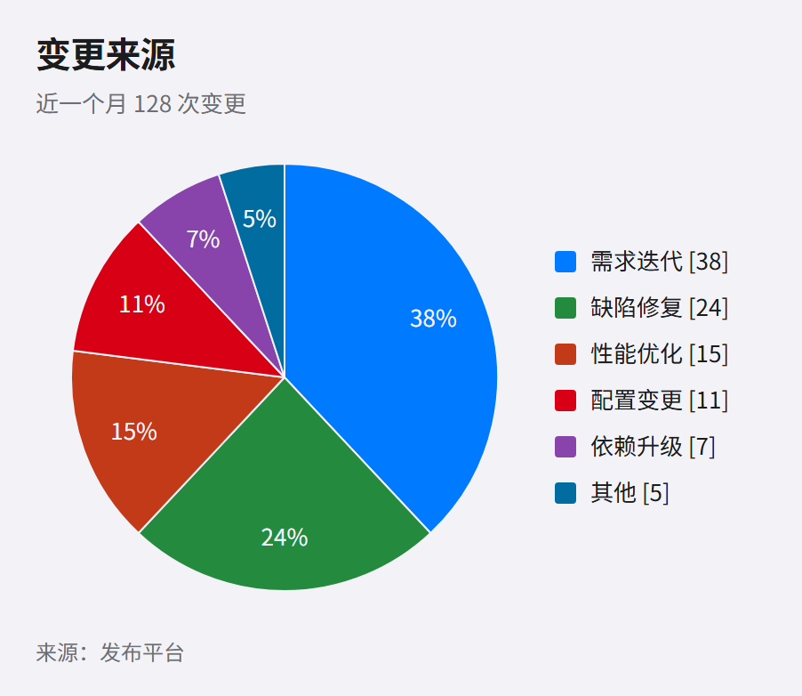

> English · [中文](ios.md) · [Back to gallery](../GALLERY.en.md)

# ios

The iOS system interface: a grouped light-grey page (`#F2F2F7`), white cards, hairline separators (`#D1D1D6`), and system colours (blue `#007AFF`, green `#34C759`, orange `#FF9500`, purple `#AF52DE`); 12px radii and a very light card shadow. Built for product UI screenshots, iOS app docs, and anything that should read as a system surface.

Block pages follow the HIG grouped-list recipe: no accent stripe down the cards, the tint lands on values and controls only (`.kpi-value.is-focus`, progress bars, list bullets), and rows are separated by hairlines rather than coloured borders.

The style is **flat**: no backdrop, no shadows, no blurred tint — just the grouped grey page, white cards, hairline separators and system-coloured outlines. The first version layered a blurred tint over the grey page for depth; that was judged a failure and removed.

The system colours are Apple's darker variants (green `#248A3D`, orange `#C93400`, red `#D70015`, purple `#8944AB`), which put the outlines at 3.6–5.4:1 against the page and clear the 3:1 floor for non-text marks.

Block pages (`kpi` / `card` / `table`) are HTML layouts and use the same system colours on the grey background.

## Flowchart

## Pie

## KPI

## Cards

## Table

## Related

- [Theme customisation](../HUMAN_GUIDE.en.md#theme-customisation)
- [Extension blocks](../EXTENSIONS.en.md)
