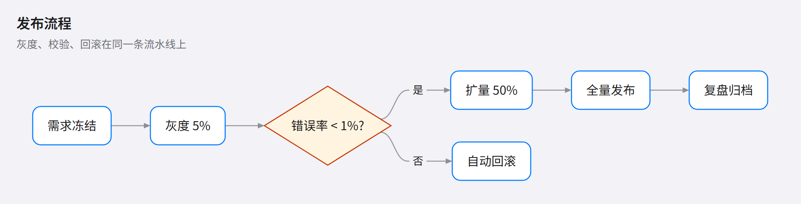
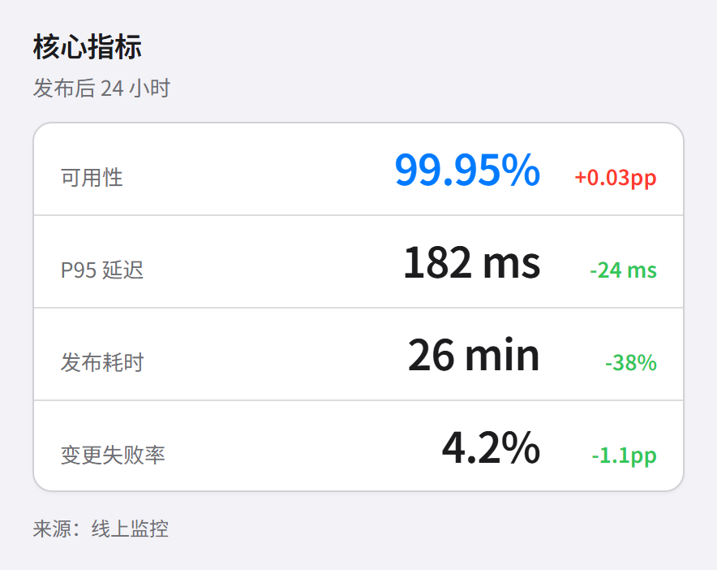
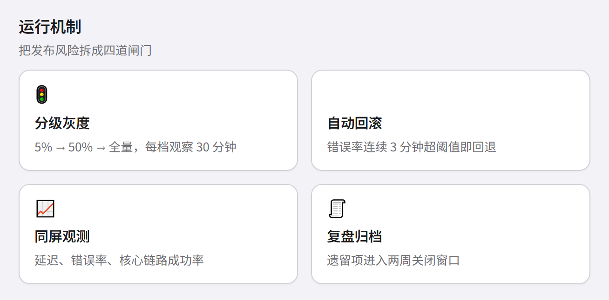
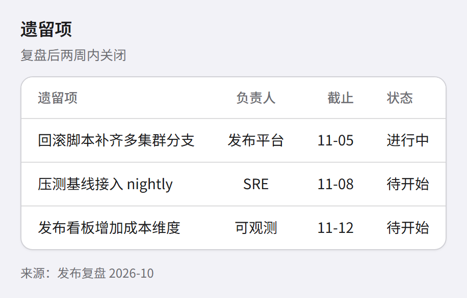

> [English](ios.en.md) · 中文 · [返回画廊总览](../GALLERY.md)

# ios

iOS 系统界面风：分组浅灰底（`#F2F2F7`）+ 白卡片 + 发丝分隔线（`#D1D1D6`）+ 系统色（蓝 `#007AFF`、绿 `#34C759`、橙 `#FF9500`、紫 `#AF52DE`），12px 圆角，卡片一层极轻投影。适合产品界面截图、iOS 应用说明、需要「系统感」的图。

块页按 HIG 的分组列表做法：卡片不加左侧强调色条，强调色只落在数值与控件上（`.kpi-value.is-focus`、进度条、列表圆点），行间用发丝分隔线而不是彩色边框。

**纯平面**：不画底、不加投影，也没有模糊色块——只有分组浅灰底、白卡片、发丝分隔线和系统色描边。第一版曾在浅灰底上叠一层模糊色块做「立体感」，判定为败笔后移除。

系统色用 Apple 的深色变体（绿 `#248A3D`、橙 `#C93400`、红 `#D70015`、紫 `#8944AB`），描边对底 3.6–5.4:1，满足非文本图形的 3:1 底线。

块页（`kpi` / `card` / `table`）走 HTML 版式，用同一套系统色和浅灰底。

## 流程图

## KPI

## 卡片

## 表格

## 相关

- [主题定制](../HUMAN_GUIDE.md#主题定制)
- [扩展块图鉴](../EXTENSIONS.md)
