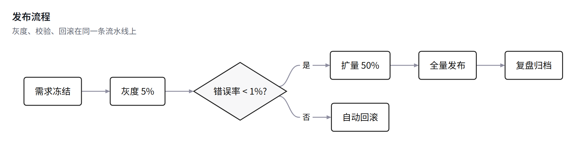
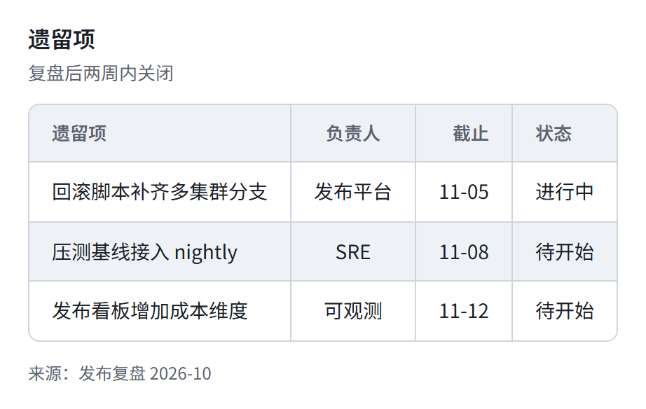

> [中文](openai.md) · English · [Back to the gallery](../GALLERY.en.md)

# openai

The near-monochrome end of the OpenAI design system: white ground, ink text, mint used only for emphasis, hairline borders, almost no shape fills. Suited to open-source READMEs, minimal engineering docs and external reports.

## Flowchart

## KPI

## Cards

## Table

## Related

- [Theming](../HUMAN_GUIDE.en.md#theming)
- [Extension blocks](../EXTENSIONS.en.md)
