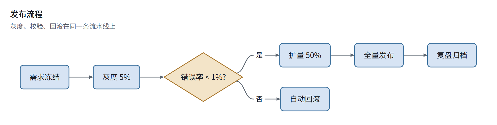
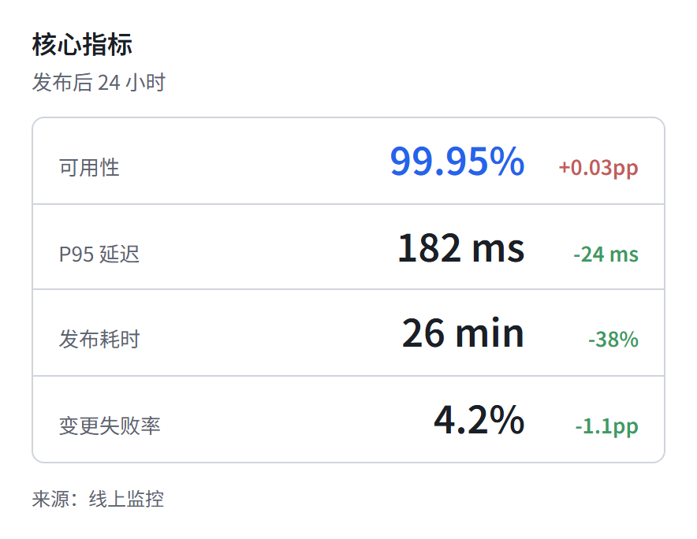
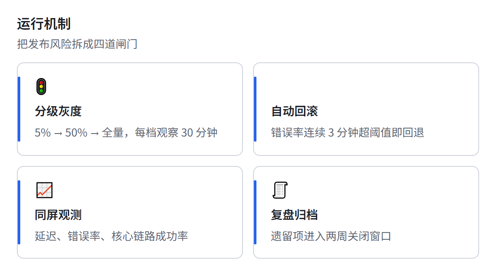
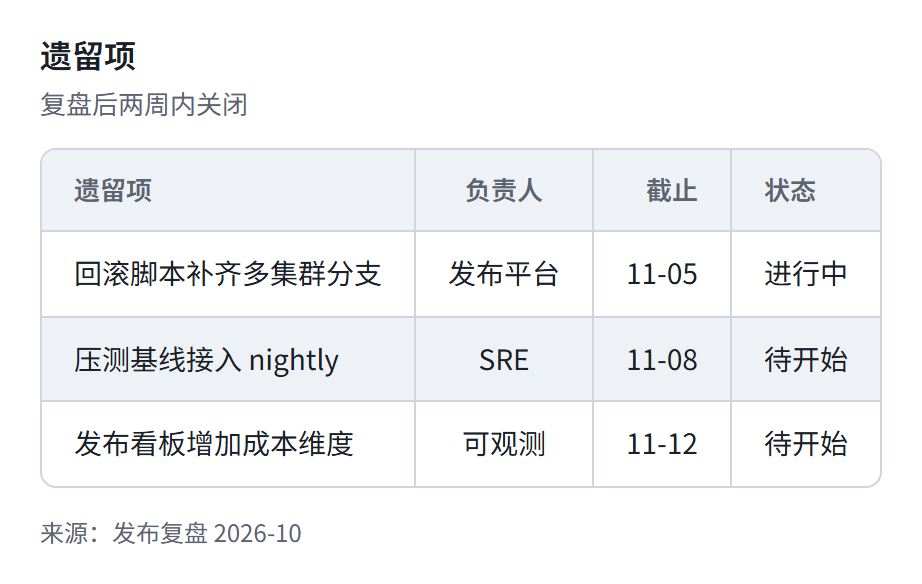

> [中文](tech.md) · English · [Back to the gallery](../GALLERY.en.md)

# tech (default)

The big-company design-doc look. Shape coding carries meaning: blue = process, amber = decision, green = state. Ready for weekly reports and review decks.

## Flowchart

## KPI

## Cards

## Table

## Related

- [Theming](../HUMAN_GUIDE.en.md#theming)
- [Extension blocks](../EXTENSIONS.en.md)
