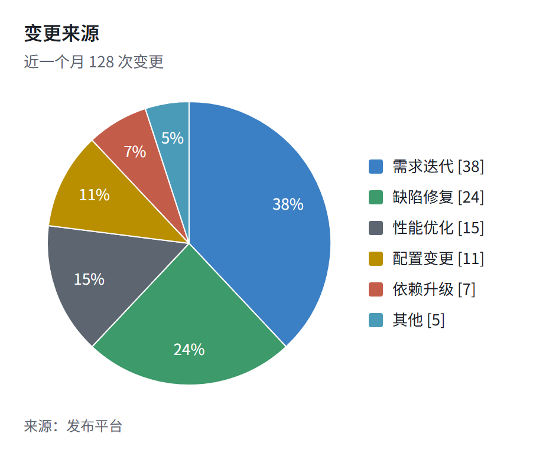

> [English](tech.en.md) · 中文 · [返回画廊总览](../GALLERY.md)

# tech（默认）

大厂方案文档风。形状分色承担语义：蓝=流程、琥珀=判定、绿=状态。适合直接贴进周报和评审材料。

## 流程图

## 饼图

## KPI

## 卡片

## 表格

## 相关

- [主题定制](../HUMAN_GUIDE.md#主题定制)
- [扩展块图鉴](../EXTENSIONS.md)
