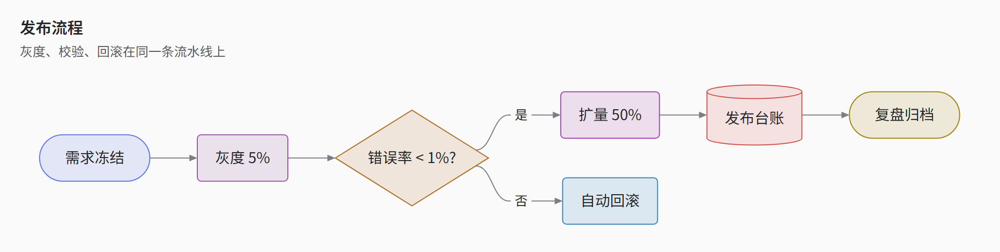
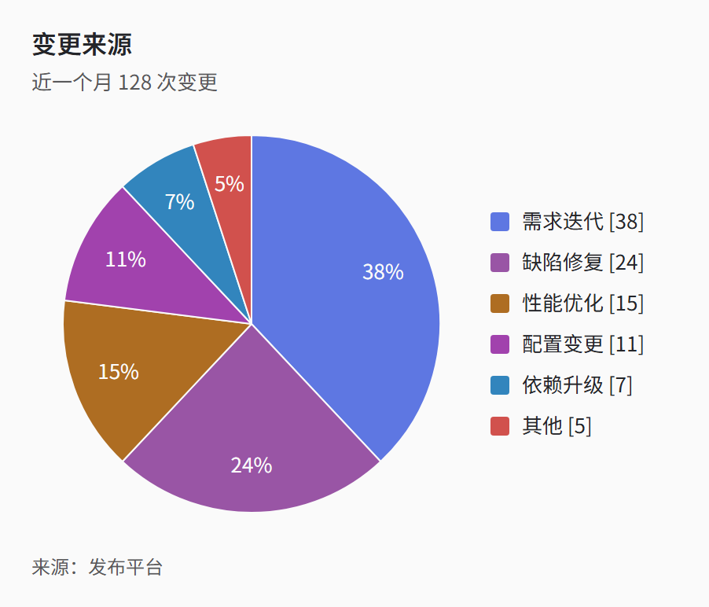
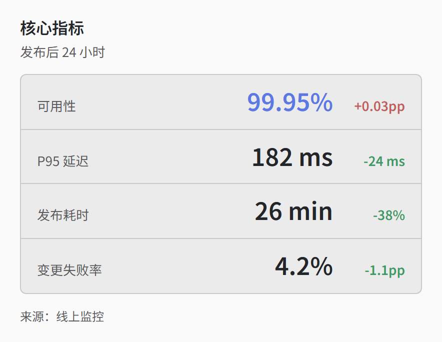
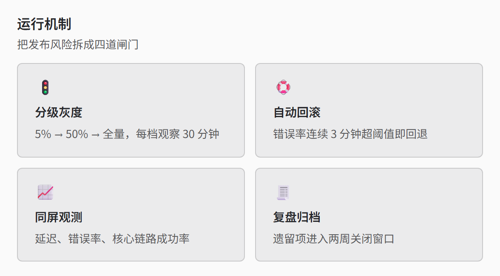
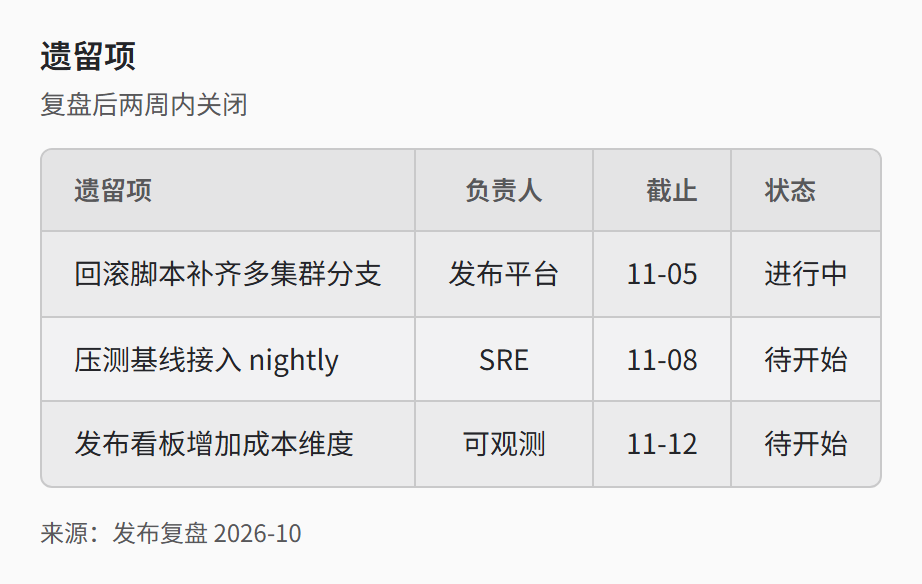

> [English](zed-light.en.md) · 中文 · [返回画廊总览](../GALLERY.md)

# zed-light

Zed 编辑器的亮色（One Light），与 [zed](zed.md) 同一套规则，只换色板：`#FAFAFA` 画布、`#242529` 正文、`#58585A` 次要文字、`#C9C9CA` 边框，1px 发丝线。适合白底文档里的编辑风，和 `zed` 配对使用（同一份源码换一个 `-t` 就是另一种底色）。

节点上色与 [zed](zed.md) 同一套：flowchart / class / state 的节点按读取顺序轮转 8 个 player 色，描边取该色、填充是该色按 15% 混页面底色——这也是它和 `tech` 最直接的差别（`tech` 按形状分色、单一蓝调，`zed-light` 按顺序多色轮转）。形状族规则负责其余槽位，取 Zed 的语法色：流程 `#5C78E2`（info 蓝）、判定 `#AD6E26`（number 赭）、状态 `#3F953A`（终端绿）、存储 `#984EA5`（keyword 品红）。8 色系列在红绿色盲模拟下两两 ΔE 最低 0.040，每色对自己的 15% 底色也 ≥ 3:1。

块页走**编辑器面板**而不是文档卡片：`#FAFAFA` 画布上放 `#EBEBEC` 面板 + `#C9C9CA` 发丝线、6px 圆角、卡片不带强调色边条，表头与热力格用更深的 `#E4E4E5`；状态 chip 照 Zed 的 error / warning chip 做法——先把强调色的亮度按 `×1.3`（暗色页 `×0.7`）抬高，再由这个底色推导文字色。

## 流程图

## 饼图

## KPI

## 卡片

## 表格

## 相关

- [主题定制](../HUMAN_GUIDE.md#主题定制)
- [扩展块图鉴](../EXTENSIONS.md)
