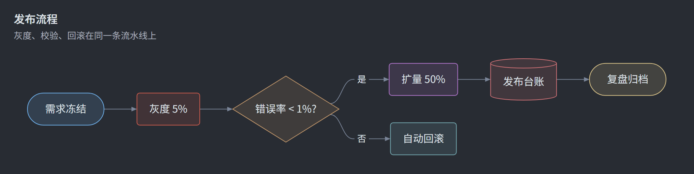
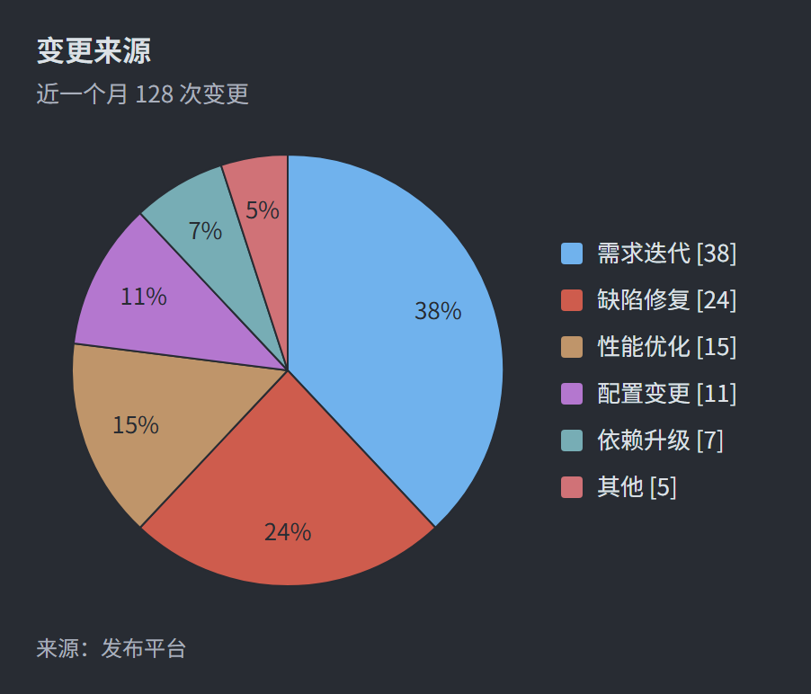
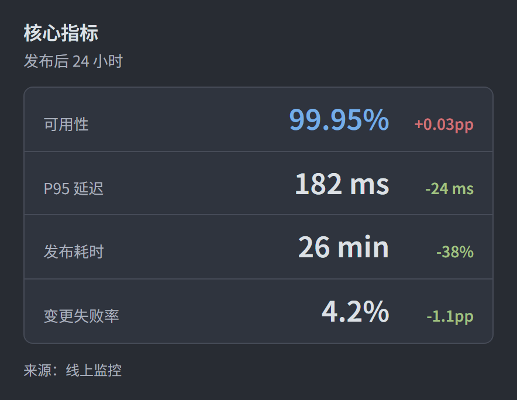
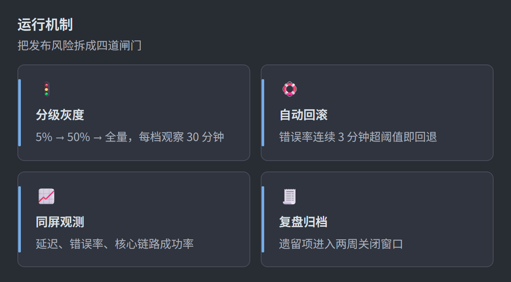
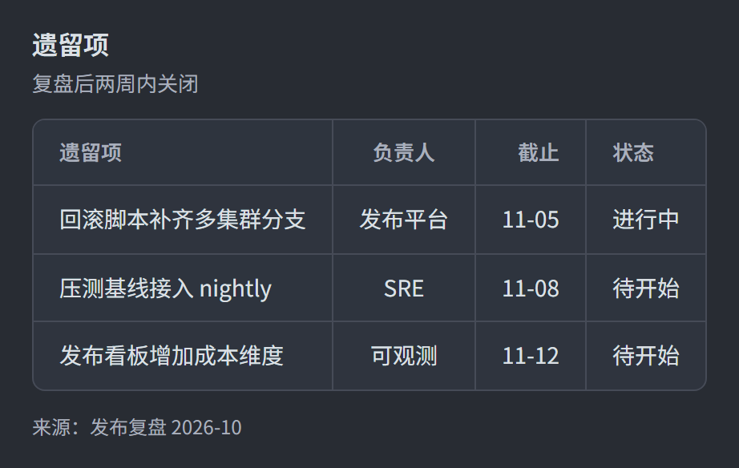

> English · [中文](zed.md) · [Back to gallery](../GALLERY.en.md)

# zed

Zed's dark editor theme (One Dark), with the palette taken straight from Zed's `assets/themes/one/one.json`: `#282C33` canvas, `#DCE0E5` body text, `#A9AFBC` secondary text, `#464B57` border, 1px hairlines, no shadow, no texture, no hand-drawing. Built for dark docs sites, tech talks, READMEs and terminal-adjacent deliverables.

Nodes are coloured the way Zed colours them: **flowchart / class / state nodes walk the eight player colours by reading order (`node_counter % 8`), each taking the accent as its outline and that accent at 15% over the page as its fill** — so a zed diagram is multi-hue rather than shape-coded. Pele writes a diagram's nodes into one `<g>` in document order, so the rotation is a set of `:nth-child` rules; state start/end markers and composite frames are chrome and stay out of it. The shape-family rules still paint the other slots (ER entities, notes, class dividers, state markers, clusters) in Zed's syntax colours — process `#74ADE8` (info blue), decision `#BF956A` (number sand), state `#A1C181` (created green), store `#B477CF` (keyword purple). The 8-colour series *is* that player palette (pie, git branches, `cScale`): every pair stays at least ΔE 0.040 apart under simulated protanopia / deuteranopia / tritanopia, and every colour clears 3:1 against its own 15% tint.

Block pages follow the same sheet: `#2F343E` panels, `#464B57` hairlines, `color-scheme: dark`; a status chip's text is derived from the chip's own stock (OKLab keeping 15% of its chroma, binary search to hold 4.5:1), so one rule covers light and dark stocks. `--tone paper` repaints onto the light ruled sheet, and the tone wins over the dark palette.

The light half of the pair is [zed-light](zed-light.md).

## Flowchart

## Pie

## KPI

## Cards

## Table

## Related

- [Theming](../HUMAN_GUIDE.en.md#theming)
- [Extension blocks](../EXTENSIONS.en.md)
