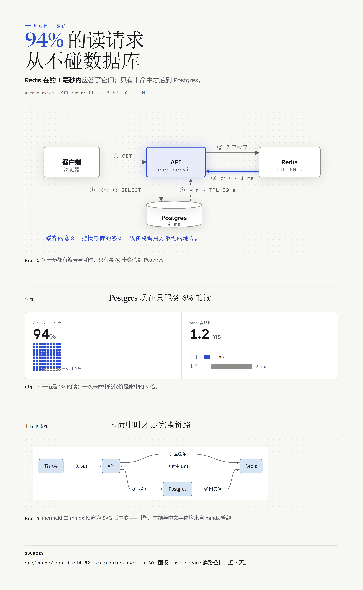

# 专题：两个 vendored skill 的实渲展示（v1.4.2）

> 两张图出自**同一条链路**：手绘自包含 HTML → `mmdx file.html --scale 3`（系统 Edge 免下载、内嵌三家族中文字体、导出自动 figure lint）。源文件在 `tests/`，可复现。

## editorial —— diagram-design 规格（精美档：封面 / 方案插图）

- 源：`tests/editorial-showcase/layer-stack.html`，按 [skill/editorial/](../skill/editorial/README.md) 规格（paper/ink 色板、4px 网格、mono sublabel）手绘
- 命令：`mmdx tests/editorial-showcase/layer-stack.html -o docs/showcase-editorial.png --scale 3`
- 本版新能力实证：**中文 serif 标题离线可靠**（serif 栈自动落内嵌 Noto Serif SC，1.4.x 时代「标题不赌 serif」的限制解除）；底部楷体旁注为内嵌霞鹜文楷（`'LXGW WenKai'`）；几何（越界/压字/粘连）由导出 lint 自动把关，本图 warnings = 0

## explain —— visual-explainer 规格化改造版（叙事档：解释页 / 评审页 / recap / 幻灯片页）

- 源：`tests/explain-e2e/cache-read-path.html`，由 `skill/explain/kit/starter-paper.html` 装配（starter 已内联 kit.css + defs + paper register 拉丁字体），页身为手绘机制图 + 手写展开的 waffle/bars + mmdx 预渲内联的页内 mermaid
- 命令：`mmdx tests/explain-e2e/cache-read-path.html -o docs/showcase-explain.png --scale 3`
- 本版新能力实证：上游 renderer 零随附（路线 D），中文三家族由管线注入（宋体标题 / 黑体正文 / 楷体旁注），mermaid 预渲吃 mmdx 引擎与中文字体，导出 lint warnings = 0

两档的分界与纪律见 [skill/SKILL.md](../skill/SKILL.md)「场景分级」；告警语义见 [skill/references/troubleshooting.md](../skill/references/troubleshooting.md)。
