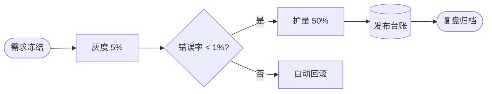

# 灰度发布复盘

风格画廊的固定案例：同一条发布流水线、同一组指标、同一份遗留清单。



```chart
type: pie
title: 变更来源
source: 发布平台
需求迭代, 38
缺陷修复, 24
性能优化, 15
配置变更, 11
依赖升级, 7
其他, 5
```

```kpi
可用性 | 99.95% | +0.03pp
P95 延迟 | 182 ms | -24 ms
发布耗时 | 26 min | -38%
变更失败率 | 4.2% | -1.1pp
```

```card
🚦 | 分级灰度 | 5% → 50% → 全量，每档观察 30 分钟
🛟 | 自动回滚 | 错误率连续 3 分钟超阈值即回退
📈 | 同屏观测 | 延迟、错误率、核心链路成功率
🧾 | 复盘归档 | 遗留项进入两周关闭窗口
```

```table
| 遗留项 | 负责人 | 截止 | 状态 |
|:-------|:------:|-----:|:-----|
| 回滚脚本补齐多集群分支 | 发布平台 | 11-05 | 进行中 |
| 压测基线接入 nightly | SRE | 11-08 | 待开始 |
| 发布看板增加成本维度 | 可观测 | 11-12 | 待开始 |
```
