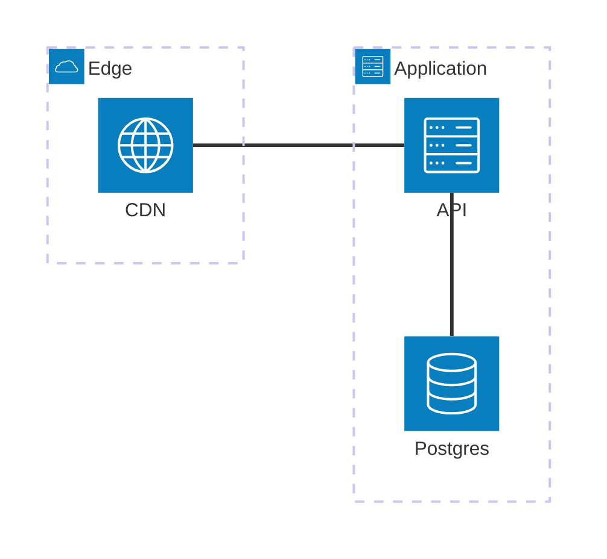
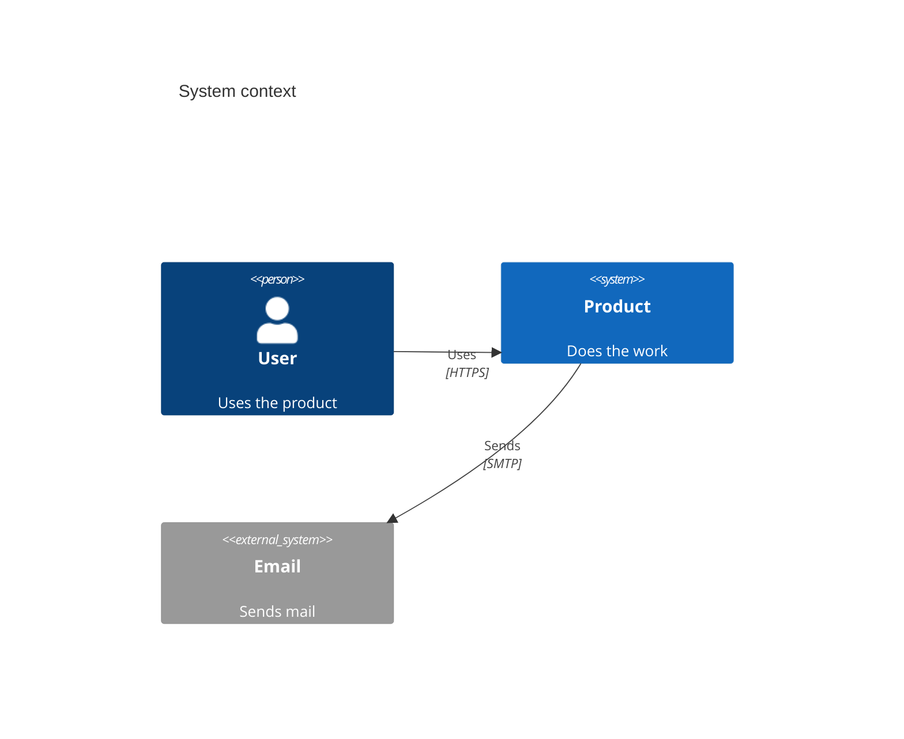
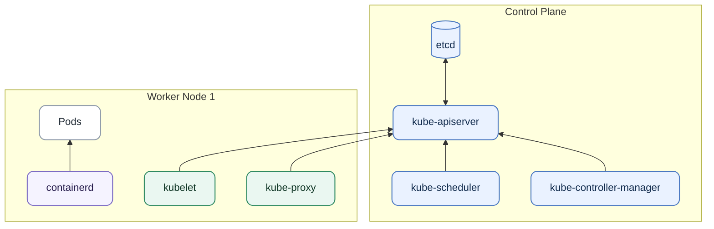
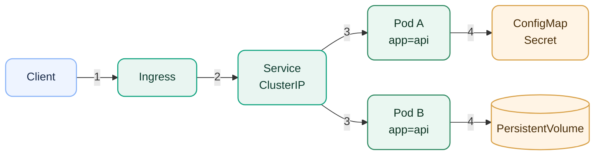
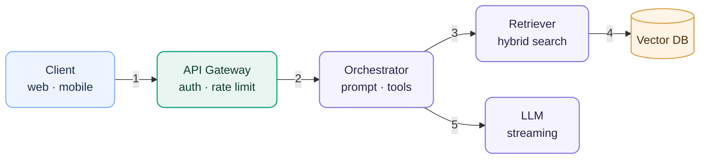

# architecture-beta / C4 / K8s / 技术解释图速查

完整示例与限制见 [`docs/ARCHITECTURE.md`](../../docs/ARCHITECTURE.md)。

## 何时用

- `architecture-beta`：云服务分层、VPC/区域/命名空间边界、CI/CD、服务 ↔ 数据存储。
- `C4Context`：系统上下文，明确人 / 当前系统 / 外部系统。
- `flowchart BT` + 子图：K8s 集群架构（控制平面 / 工作节点）。
- `flowchart LR` + `classDef`：K8s 服务访问路径、ChatGPT/OpenAI 风技术解释图。
- 需要判定分支、泳道、逐条协议/带宽标注 → `flowchart`；需要时序 → `sequenceDiagram`。

## architecture-beta



| 写法 | 含义 |
| --- | --- |
| `group id(icon)[Title]` | 边界；`in` 嵌套 |
| `service id(icon)[Title] in group` | 服务节点 |
| `junction id` | 连线拐点 |
| `a:R -- L:b` | 端口 `L/R/T/B` |
| `a:R --> L:b` | Pele 当前画线不画箭头 |
| `a{group}:R -- L:b{group}` | 跨组边界 |

内置图标：`cloud` / `server` / `database` / `disk` / `internet`，离线可用。Iconify：`--icon logos` + `service api(logos:aws-ec2)[API]`，首次联网拉取并缓存。组 ≤5、服务 ≤12；复杂嵌套先 `-f svg` 检查。

## C4



`Person` / `System` / `System_Ext` / `Rel`；`Rel` 第 4 参数是协议，可省略。C4 的颜色由主题 `c4.*` token 控制。

## Kubernetes 集群架构



- `flowchart BT`：API server 作为目标在顶部，kubelet / kube-proxy 作为来源在底部，箭头自然指向 API server。
- `direction LR` 让组内组件横排；三节点就复制一份 Worker 子图。
- 官方英文组件名；`containerd` 可换 CRI-O；`cloud-controller-manager` / CoreDNS / Ingress Controller 按需加入。
- 单图 ≤12 个组件；全量集群超过概览 9 节点提示属于正常。

## Kubernetes 服务访问路径



真实数据面是 `Service → EndpointSlice → Pod`；示意图保留 `Service → Pod` 的简化写法。配置/存储走旁路。

## 技术解释图（OpenAI / ChatGPT 风）

主题 `-t openai`，四组层色，编号请求流，`--title` / `--subtitle` / `--source`。



| 层级 | fill | stroke | text | class |
| --- | --- | --- | --- | --- |
| 客户端 / 入口 | `#EEF4FF` | `#8AB4F8` | `#1A2B4A` | `client` |
| 网关 / 边界 | `#E9F5F1` | `#10A37F` | `#0D3B2E` | `edge` |
| 服务 / 计算 | `#F5F3FF` | `#8B7BD8` | `#2A1F4A` | `service` |
| 数据 / 状态 | `#FFF4E5` | `#D9A24A` | `#4A2F0A` | `data` |

规则：层色 ≤4；同层同色；标签两行内；请求步骤 ≤6；异步/观测用 `-.->`；不加阴影/渐变/伪 3D；品牌色改 `--theme-js` 的 `accent`，classDef 保持不变。

## 交付

```bash
mmdx arch.mmd -t tech -o arch.png --scale 2 --json
mmdx c4.mmd -t openai -o c4.png --scale 2 --json
mmdx k8s.mmd -t openai --title "Kubernetes 集群架构" \
  --subtitle "控制平面、工作节点与核心组件" -o k8s.png --scale 2
mmdx tech.mmd -t openai --title "LLM 请求链路" -o tech.png --scale 2
```

`--json` 看 `rendered:1`；Read PNG 看边界、标签、层级色是否清楚。`architecture-beta` 是 Mermaid beta，Pele 的箭头端暂不绘制，需要箭头时改用 `flowchart`。
