# mermaid 图型示例与特殊画法（按需读取）

> 写 mermaid 图型抄最小语法、或要组合版式（并列/嵌套/分层）时读本文。示例全部来自本仓库 `tests/diagrams/` 已验证 fixture 与专项验证，抄了就能渲染。扩展围栏（table/chart/kpi…）语法见 [fences.md](fences.md)。

## 一、图型最小示例（16 种常用）

````markdown
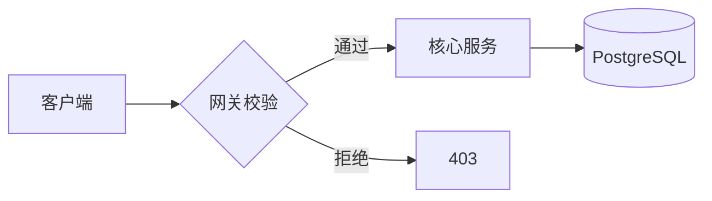

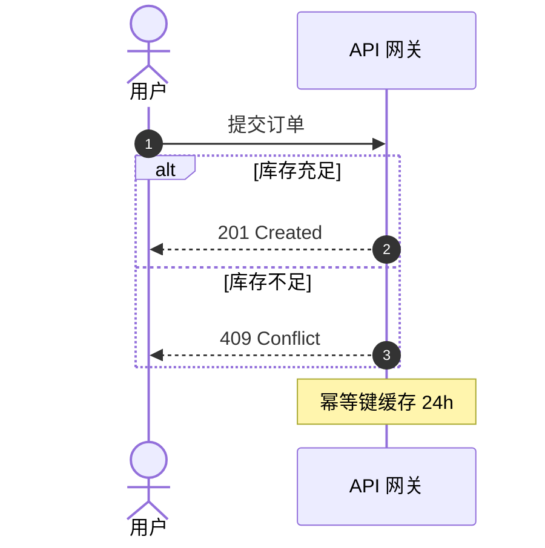

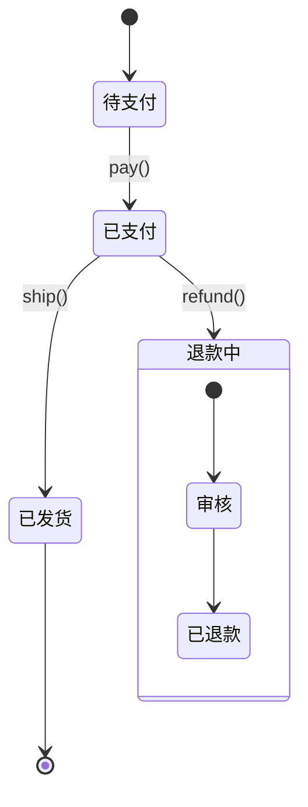

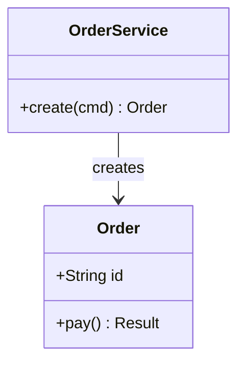

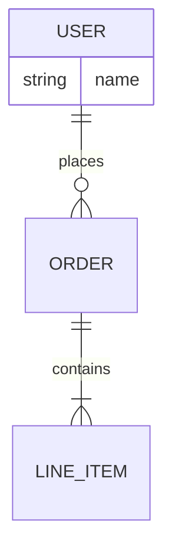

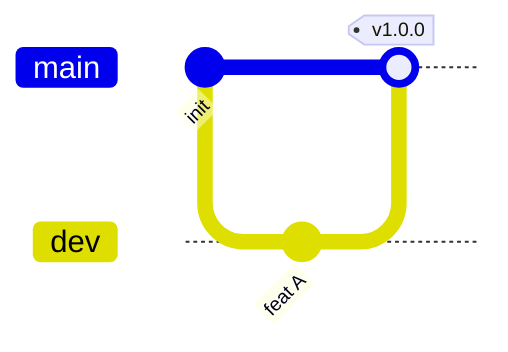

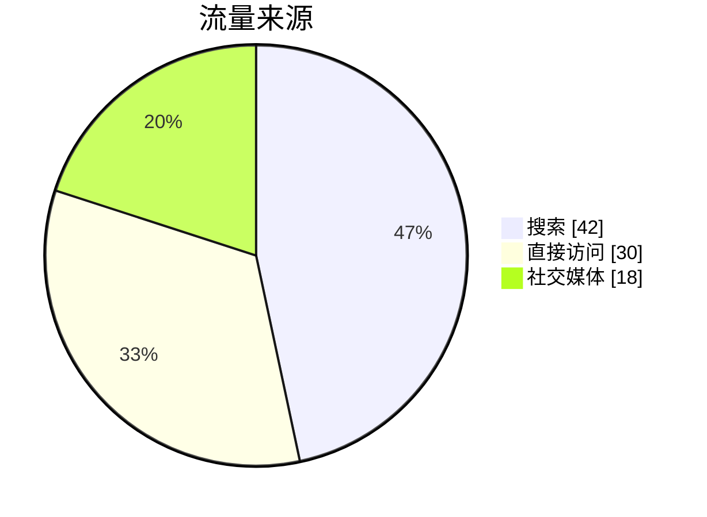

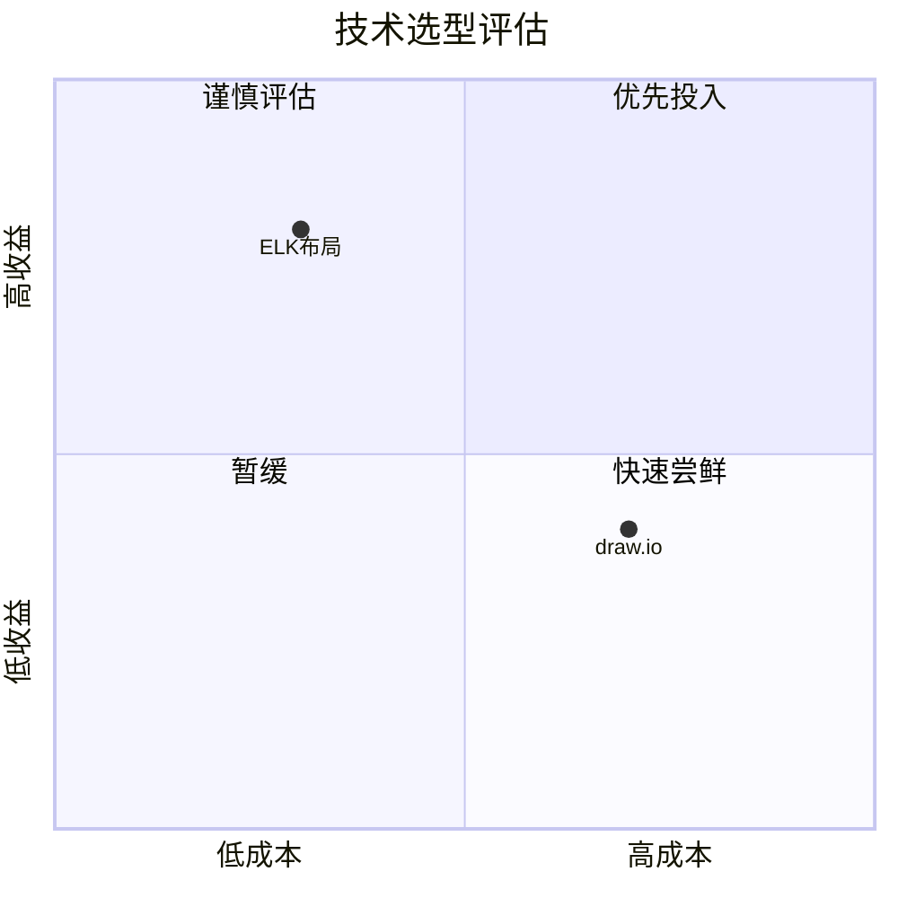

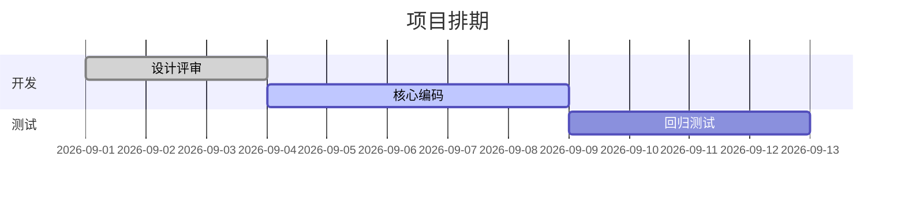

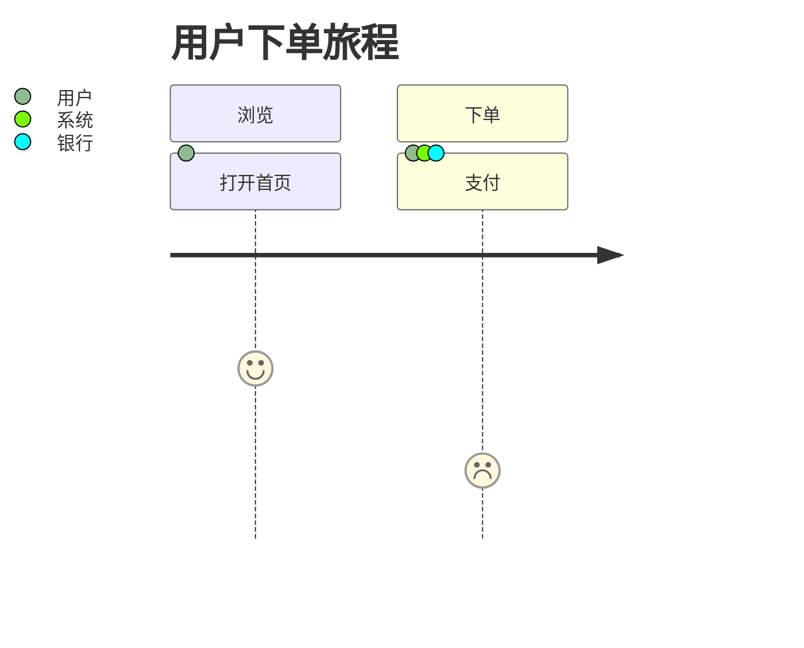

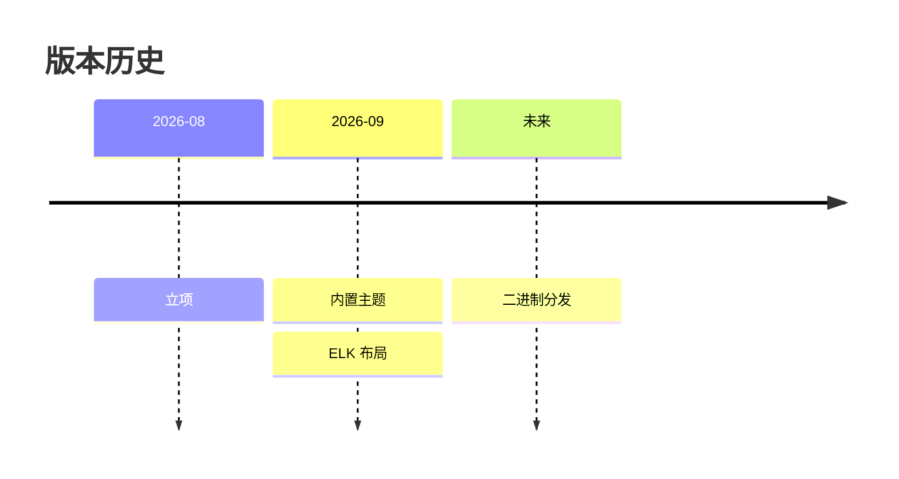

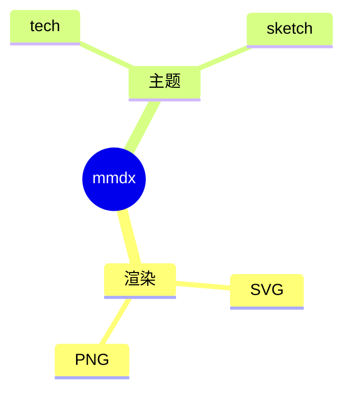

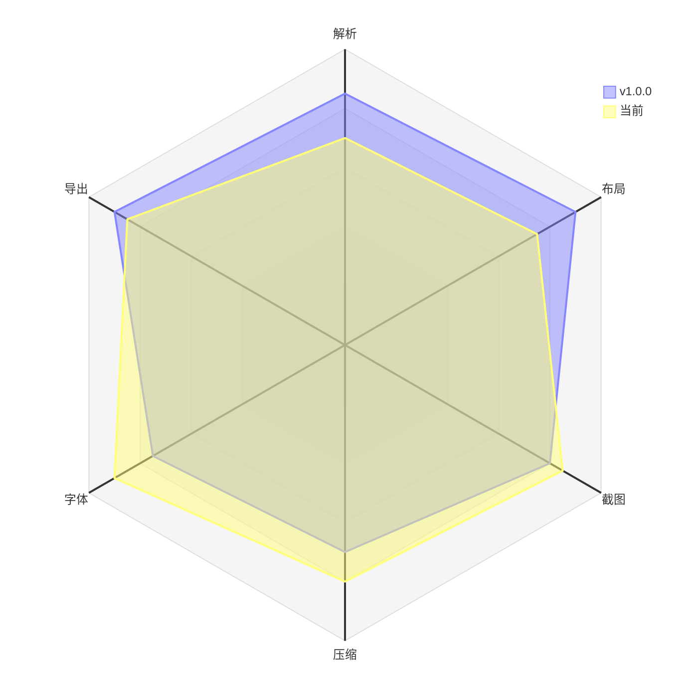

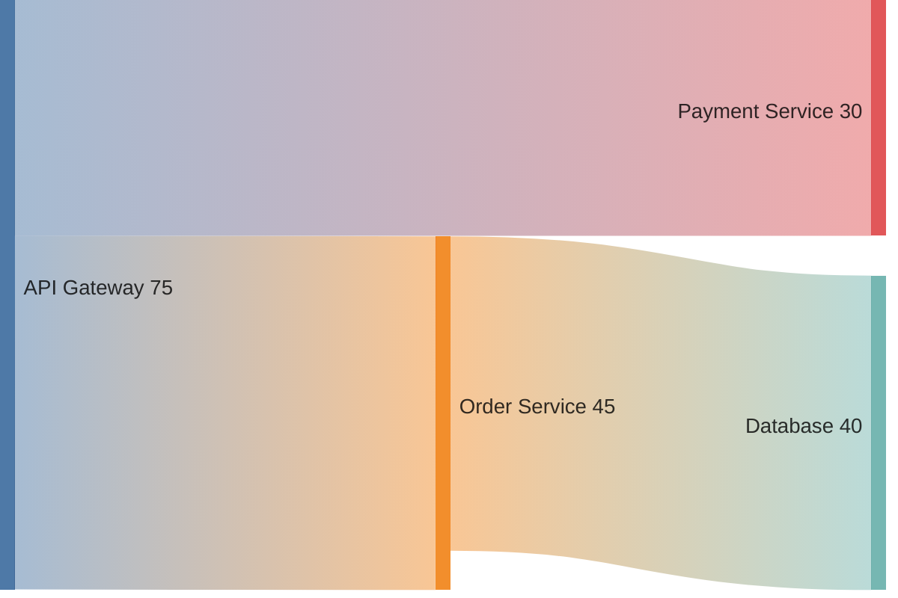

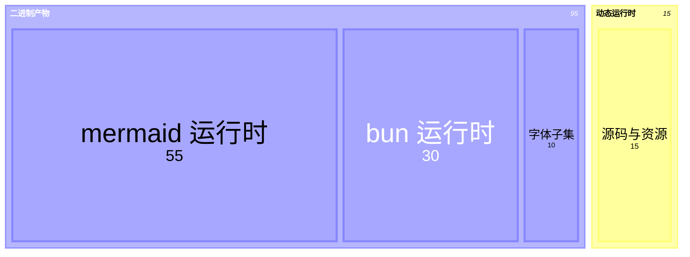


````

C4：`C4Context` / `C4Container`（深色块 + 小人需 `--engine mermaid`，默认 Pele 画成浅色办公卡）。`xychart` **不要手写**——趋势/柱状走 ` ```chart ` 围栏（有预算检查和图题层）。

## 二、特殊画法（组合版式，已验证）

### 1. 一图两个并列流程，方向各异（LR + TB 混排）

subgraph 内 `direction` 各自生效——**仅默认 Pele 引擎支持**；`--engine mermaid`（ELK）会忽略 `direction`，两块都变纵向。

````markdown
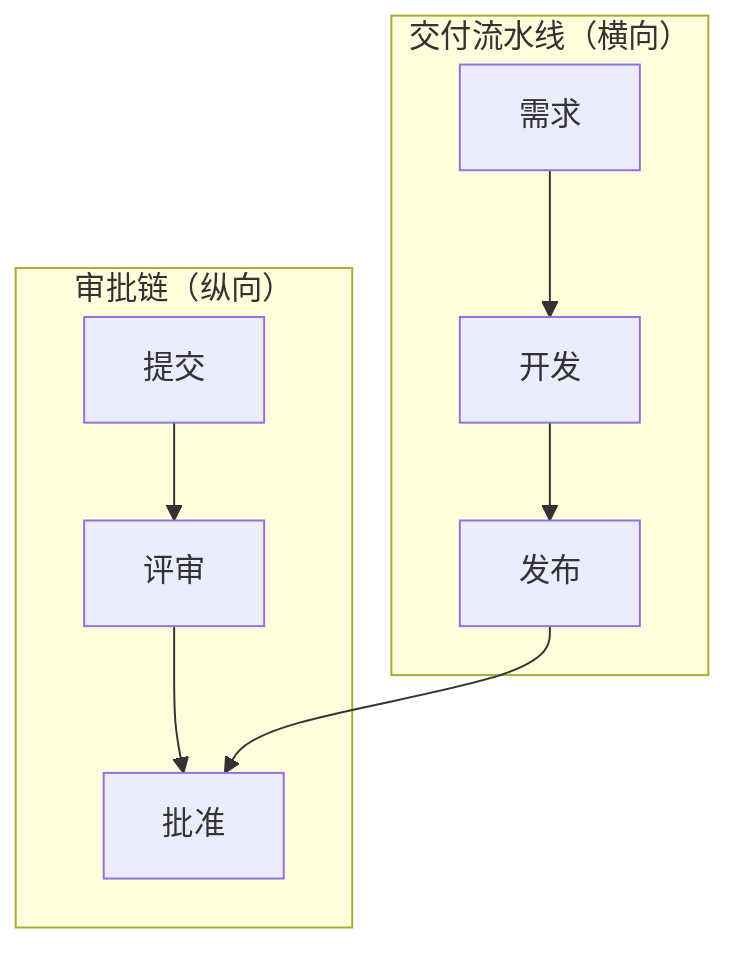
````

要点：subgraph 必须命名（`subgraph id["显示名"]`）；跨组连线（`C --> F`）放在两组之外声明。

### 2. 嵌套包含（部署 / 包含关系）

subgraph 套 subgraph，外层画容器、内层画成员；Pele 下成员位置更贴源码。

````markdown
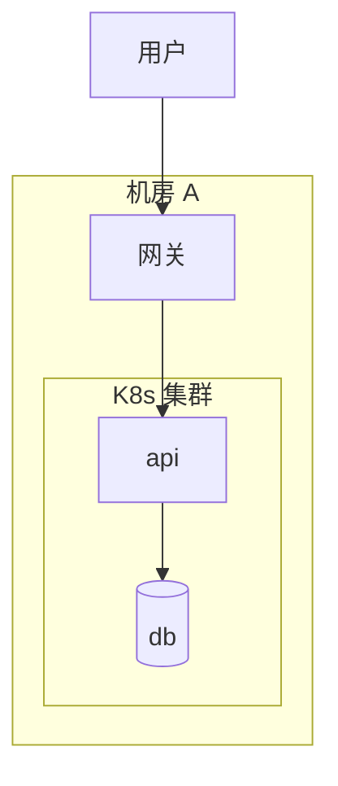
````

### 3. 组织架构树

`flowchart TD` 天然自顶向下树，不需要别的语法；**不要**用 `LR` 画组织架构。汇报关系就是边，虚线管理线用 `-.->`。

### 4. 分层横切（层叠 / 泳道式 lanes）

并列命名 subgraph 当层，层内正常连线，层间只留少量关键边；配色交给主题。真正跨部门 handoff 场景改用 ` ```swimlane ` 围栏（见 [fences.md](fences.md)）。

### 5. 对照式 timeline（事件 vs 对策）

每个时期固定两行：第一行写"发生的事"，第二行写"对应的处置"，读者竖着扫任何一列都是完整叙事。适合攻击链 vs 防线、事故 vs 响应、变更 vs 回滚这类**阶段对阶段**的对照——比 flowchart 两条平行链省一半节点数预算，且没有交叉连线。两行的语义要在 `--title` 里点明（如"攻击链 vs 防线"），否则读者不知道第二行是对策。

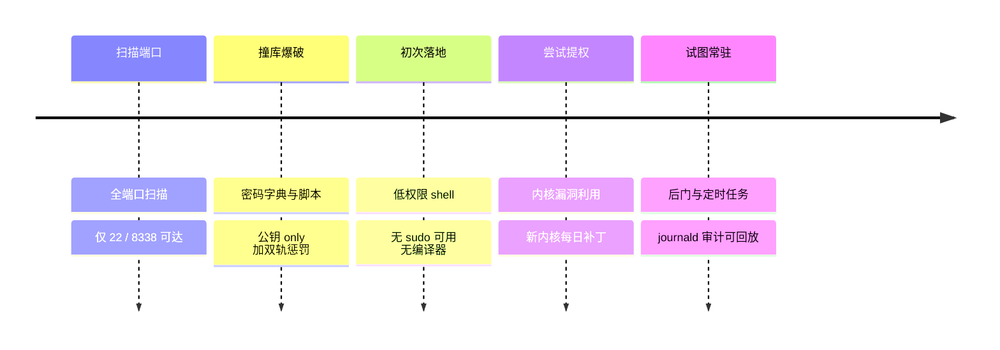

出图要作者署名 / 水印，用图题层 `--source` 印在 PNG 页脚（mermaid 图型与扩展围栏通用）：

```bash
mmdx attack-chain.mmd --preset column --title "自动化攻击链 vs 每层防线" --source "© daidaiJ" -o attack-chain.png
```

